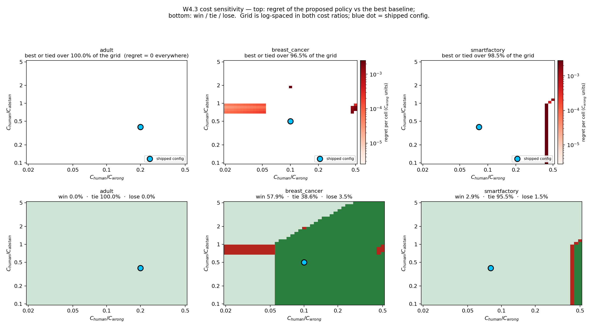
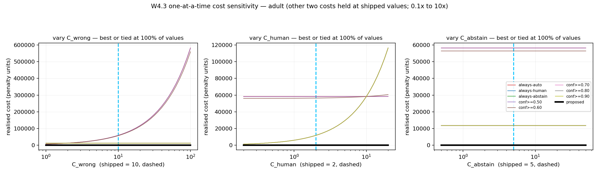
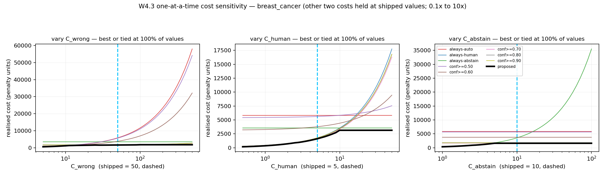
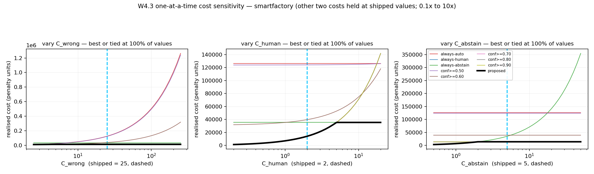

# W4.3 — Cost sensitivity and cost provenance

Route W4.3 of `docs/research_program.md` §9. Answers reviewer gap **G2**: *"the decision costs need a defensible interpretation."* Generated by `python experiments/w4_costs.py` (seed 42, full datasets, mock repair mode, shipped detector defaults). Every number below comes from that run; nothing is hand-edited.

All costs are abstract **experimental penalty units** (`configs/costs.yaml`). Not money, not clinical harm, not supplied by the REIN benchmark.

---

## 0. The three questions, answered

| question | answer |
|---|---|
| Are the costs **fixed**? | Yes. Read from `configs/costs.yaml` by `CostConfig.from_yaml`. §1 proves it four ways. |
| Are they **learned**? | No. No optimiser, loss or gradient touches them. `CostConfig` is a frozen dataclass, so nothing can even mutate one. |
| Are they **selected using test outcomes**? | No — with one historical exception, stated in full in §1.3: adult's `c_leave_error` was hand-set to 1 on 2026-09-22 to make ABSTAIN reachable, and **reverted to its original 5** in the next commit once the learned `q` made the hand-set value unnecessary. `c_wrong_repair` and `c_human_review` have never changed since the initial commit. |

### Sensitivity headline

| dataset | best or tied | strictly best | loses | worst regret (C_wrong units) | worst regret, % of best baseline |
|---|---:|---:|---:|---:|---:|
| adult | **100.0%** | 0.0% | 0.0% | 0.00 (0.0000 per cell) | **0.00%** |
| breast_cancer | **96.5%** | 57.9% | 3.5% | 0.88 (0.0025 per cell) | **4.68%** |
| smartfactory | **98.5%** | 2.9% | 1.5% | 19.76 (0.0028 per cell) | **0.65%** |

The last two columns are the ones to read. Where the proposed policy loses at all it loses by a **single-digit percentage of the best baseline's cost**, in narrow slivers of the grid; where it wins it wins by far more (§5). The zero-regret headline of `results/RESULTS.md` §1 is not knife-edge: it sits in the interior of a large region, not on a point. **Read the 'strictly best' column too** — adult's 100% is 100% of *ties* with `always-abstain`, and smartfactory is mostly tied with `always-human`. Robustness and superiority are different claims, and this table separates them.

Over a 41×41 log-spaced grid (1,681 cost configurations per dataset) spanning C_human/C_wrong ∈ [0.02, 0.5] and C_human/C_abstain ∈ [0.1, 5.0] — a 25× range in the first ratio and a 50× range in the second.

---

## 1. Provenance proof — the costs are fixed inputs

### 1.1 Mechanical evidence

**Immutability.** `CostConfig.__dataclass_params__.frozen = True`. A frozen dataclass rejects attribute assignment, so no evaluation result, metric or sweep can write back into a cost object. The only way a cost value exists is to be passed in at construction.

**Round-trip.** The YAML file is parsed independently here and compared with `CostConfig.from_yaml`'s output: **match = True**.

| dataset | YAML literal (wrong / human / leave) | loaded by `from_yaml` | ratios α, β |
|---|---|---|---|
| adult | 10 / 2 / 5 | 10 / 2 / 5 | 0.200, 0.400 |
| breast_cancer | 50 / 5 / 10 | 50 / 5 / 10 | 0.100, 0.500 |
| smartfactory | 25 / 2 / 5 | 25 / 2 / 5 | 0.080, 0.400 |

### 1.2 The loading path, and every construction site in the repo

```
configs/costs.yaml
        |
        v
CostConfig.from_yaml(path, dataset)      src/risk/cost_model.py
        |   frozen dataclass: c_wrong_repair, c_human_review, c_leave_error
        v
DecisionPolicy.from_cost_config(costs)   src/decision/policy.py
        |
        v
decide_all(bundle, costs)                src/pipeline/runner.py
        |   p from the Phase 6 calibrator, q from the Phase 6b calibrator
        v
evaluate_policies(bundle, costs, ...)    costs are an ARGUMENT, never a return
```

The flow is one-way. `evaluate_policies` and `CostEvaluator` consume a `CostConfig`; neither returns one, and neither can modify the one it was given. There is no code path from a metric back to a cost.

Every place a `CostConfig` is created anywhere in the repo (tests excluded):

| site | how the values arise |
|---|---|
| `app.py:182` | explicit literal arguments |
| `app.py:192` | reads configs/costs.yaml |
| `app.py:194` | hard-coded fallback (10/2/5), config missing |
| `demo_risk.py:130` | reads configs/costs.yaml |
| `experiments/smoothing_ablation.py:93` | reads configs/costs.yaml |
| `experiments/three_actions_ablation.py:372` | reads configs/costs.yaml |
| `experiments/w4_routing.py:874` | reads configs/costs.yaml |
| `run_experiment.py:457` | reads configs/costs.yaml |

`app.py:182` (`make_costs`) is the Streamlit dashboard's three sliders: a **human** moves them to demonstrate that the same confidence yields different actions under different costs. That is the thesis demo, not a fit — it reads a widget, not a metric. `app.py:192` loads the YAML defaults for the sliders' initial positions.

### 1.3 The complete change history of `configs/costs.yaml`

Three commits have ever touched the file (3 found):

| commit | date | subject |
|---|---|---|
| `7738125` | 2026-09-22 | Step 4: wire learned q through the runner; restore Adult's original costs |
| `717b4a7` | 2026-09-22 | Make ABSTAIN reachable: set Adult c_leave_error below c_human_review |
| `ea64ec9` | 2026-09-12 | Initial commit - data repair project |

Which commits changed each value (`git log -G` on the key, **not** `-S`: `-S` counts occurrences of a string and would miss a `5` -> `1` edit on the same line):

| value | commits that changed it |
|---|---|
| `c_wrong_repair` | `ea64ec9` (1) |
| `c_human_review` | `ea64ec9` (1) |
| `c_leave_error` | `7738125`, `717b4a7`, `ea64ec9` (3) |

**The one exception, stated plainly.**

`c_wrong_repair` and `c_human_review` have **never** been modified since the initial commit. `c_leave_error` was changed exactly once and then put back:

1. `717b4a7` (2026-09-22) — *"Make ABSTAIN reachable: set Adult c_leave_error below c_human_review"* set adult's `c_leave_error` from 5 to **1**. This was a cost chosen to produce a desired behaviour (a reachable third action), i.e. exactly the thing the reviewer is right to be suspicious of. `CLAUDE.md` §5.2 records it as "cheapest defensible fix".
2. `7738125` (2026-09-22) — *"Step 4: wire learned q through the runner; restore Adult's original costs"* set it back to **5**, the original value, because the learned `q ≈ 0.0002` on adult's IQR false alarms makes `E[ABSTAIN] = q·5 ≈ 0.001 < C_human = 2` without any cost change. Abstention on adult now comes from *evidence about the cells*, not from a cost chosen to produce it.

The shipped file carries that note in adult's `note:` block, and `docs/cost_semantics.md` and `docs/three_actions_plan.md` record the same history. The hand-set value is in the git record, was live for one commit, and is not in any published result: every number in `results/RESULTS.md` was generated after `7738125`.

**What the costs *are*, then:** three assumptions per dataset, justified by a short domain argument in the YAML `note:` fields (medical data → a wrong repair is expensive; industrial sensors → bad imputation propagates), written before any result existed, and never revisited. §2–§5 below are the test of whether that choice mattered.

---

## 2. Method — why the sweep is over two ratios, not three costs

The policy picks the cheapest of three expected costs:

```
E[AUTO]    = (1 - p) · C_wrong
E[HUMAN]   = C_human
E[ABSTAIN] = q · C_abstain
```

`CostConfig` enforces `C_wrong > 0`, so dividing all three arms by `C_wrong` cannot change the argmin:

```
E[AUTO]/C_wrong    = 1 - p
E[HUMAN]/C_wrong   = α                 α = C_human / C_wrong
E[ABSTAIN]/C_wrong = q · α / β         β = C_human / C_abstain
```

So **the action chosen at every cell is a function of `(p, q, α, β)` alone** — two numbers, not three. The boundaries of `docs/cost_semantics.md` §4 become `p* = 1 − α` (vertical), `q* = β` (horizontal) and `p = 1 − qα/β` (sloped). Sweeping the two ratios therefore sweeps *every distinguishable decision rule* in the family; sweeping three raw values would spend most of its grid re-measuring the same rule at different scales.

Realised cost is homogeneous of degree 1 in the costs — scaling all three by λ scales every policy's total by λ — so the overall scale changes no ranking and no regret **sign**. Fixing `C_wrong = 1` loses nothing and puts realised cost and regret in units of `C_wrong`, i.e. **wrong-repair equivalents**: a regret of 50 means "as bad as 50 extra wrong auto-repairs". Multiply by a dataset's shipped `C_wrong` to get its native units.

**Realised cost** (interpretation (a), `docs/cost_semantics.md` §2):

```
cost_i = C_wrong   · [AUTO    and the applied repair is wrong]
       + C_human   · [HUMAN]
       + C_abstain · [ABSTAIN and the cell is genuinely corrupted]
```

`C_abstain` is corruption-**persistence** cost, so abstaining on a false alarm is free. Per-flag operational cost is decision-invariant (it adds a constant to all three arms) and is excluded by design, as that document requires.

**Baselines at every grid point** (8 of them, none of which can abstain except the trivial one):

`always-auto`, `always-human`, `always-abstain`, and raw-confidence thresholds at 0.50 / 0.60 / 0.70 / 0.80 / 0.90 (AUTO if `raw_confidence ≥ t`, else HUMAN). **Regret** = proposed − min over those eight at that same grid point. Regret ≤ 0 means the proposed policy is best-or-tied; the tie tolerance is 1e-9.

The baselines' *actions* do not depend on cost, so their action vectors are computed once per dataset and their cost at any point is a dot product of three fixed counts with the three costs. Only the proposed policy re-decides. The pipeline (detect → repair → uncertainty → calibrate `p` and `q`) is also cost-independent, so it runs **once per dataset** and the whole grid is scored from cached arrays. Changing a cost changes the objective, never the predictions.

### 2.1 Verification — the reimplementation is checked, not trusted

A sweep built on an unverified cost function would be worthless, so the vectorised code here is checked against the shipped code (CLAUDE.md §8b.5). Any failure aborts the run.

| check | what it compares | result |
|---|---|---|
| V1 · adult | vectorised argmin vs `DecisionPolicy.decide()`, every record × 13 cost configs | **0 mismatches** |
| V1 · breast_cancer | vectorised argmin vs `DecisionPolicy.decide()`, every record × 13 cost configs | **0 mismatches** |
| V1 · smartfactory | vectorised argmin vs `DecisionPolicy.decide()`, every record × 13 cost configs | **0 mismatches** |
| V2 · adult | realised cost vs `CostEvaluator.total_realized_cost` / closed form, 9 policies | max abs diff **0.00e+00** |
| V2 · breast_cancer | realised cost vs `CostEvaluator.total_realized_cost` / closed form, 9 policies | max abs diff **0.00e+00** |
| V2 · smartfactory | realised cost vs `CostEvaluator.total_realized_cost` / closed form, 9 policies | max abs diff **0.00e+00** |
| V3 · adult | re-derived `corrupted` mask vs pipeline `detection_labels` | **0 mismatches** |
| V3 · breast_cancer | re-derived `corrupted` mask vs pipeline `detection_labels` | **0 mismatches** |
| V3 · smartfactory | re-derived `corrupted` mask vs pipeline `detection_labels` | **0 mismatches** |
| V4 · all | `from_yaml` vs literal YAML parse | **match = True** |
| V5 · adult | shipped-config costs vs published `results/RESULTS.md` §1 | max abs diff **0.00e+00** |
| V5 · breast_cancer | shipped-config costs vs published `results/RESULTS.md` §1 | max abs diff **0.00e+00** |
| V5 · smartfactory | shipped-config costs vs published `results/RESULTS.md` §1 | max abs diff **0.00e+00** |

V5 in full — the published headline reproduced from this script's own cost function:

| dataset | policy | this script | RESULTS.md §1 |
|---|---|---:|---:|
| adult | proposed | 0 | 0 |
| adult | always-human | 11,658 | 11,658 |
| adult | always-abstain | 0 | 0 |
| adult | always-auto | 58,290 | 58,290 |
| adult | conf>=0.70 | 11,658 | 11,658 |
| breast_cancer | proposed | 1,615 | 1,615 |
| breast_cancer | always-human | 1,775 | 1,775 |
| breast_cancer | always-abstain | 3,550 | 3,550 |
| breast_cancer | always-auto | 5,800 | 5,800 |
| breast_cancer | conf>=0.70 | 1,720 | 1,720 |
| smartfactory | proposed | 14,186 | 14,186 |
| smartfactory | always-human | 14,186 | 14,186 |
| smartfactory | always-abstain | 35,465 | 35,465 |
| smartfactory | always-auto | 126,275 | 126,275 |
| smartfactory | conf>=0.70 | 14,186 | 14,186 |

---

## 3. What the policy is working with (identical at every grid point)

| dataset | decided cells | genuinely corrupted flags | repair correct | `p` range | `q` values | `p` calibrator |
|---|---:|---:|---:|---|---|---|
| adult | 5,829 | 0 (0.0%) | 0 (0.0%) | 0.000–0.000 | 0.0002 | base-rate fallback (no calibrator fitted) |
| breast_cancer | 355 | 355 (100.0%) | 239 (67.3%) | 0.000–0.947 | 0.6667, 0.9091, 0.9895, 0.9943 | isotonic |
| smartfactory | 7,093 | 7,093 (100.0%) | 2,042 (28.8%) | 0.000–0.580 | 0.9998 | isotonic |

These are the inputs the costs act on, and they explain every result below. `q* = β` is the human/abstain boundary, so a dataset's `q` values say immediately where in β the policy switches between reviewing and abstaining; `p* = 1 − α` is the auto/human boundary, so a dataset's maximum `p` says where in α auto-repair switches on at all.

---

## 4. The regret heatmaps



Top row: regret per decided cell in `C_wrong` units (0 = the proposed policy is best). Bottom row: win / tie / lose. Both axes log-spaced; the blue dot is the shipped configuration. Per-dataset versions: `figures/w4/w4_regret_adult.png`, `figures/w4/w4_regret_breast_cancer.png`, `figures/w4/w4_regret_smartfactory.png`.

### 4.1 adult

- **Best or tied at 100.0% of 1,681 grid points** (strictly best 0.0%, tied 100.0%, loses 0.0%).
- Worst regret anywhere on the grid: 0.00 C_wrong units = **0.00% of the best baseline's cost at that point**.
- No loss anywhere on the grid: the proposed policy is best or tied at all 1,681 points.
- Action mix nearest the shipped config (α=0.206, β=0.393): AUTO 0%, HUMAN 0%, ABSTAIN 100%.
- Across the whole grid the action mix ranges AUTO 0–0%, HUMAN 0–0%, ABSTAIN 100–100% — **constant across the entire grid**. On this dataset no cost ratio in the swept box moves a single decision: the evidence (p, q) is too one-sided. Its 100% is therefore 100% of TIES, not of wins, and it is weak evidence about the policy — see §6.
- Baselines that are best somewhere on this grid: always-abstain.
- Derived switch points (§2 boundaries): AUTO can fire only once α ≥ 1 − max(p) = 1.000, which is outside the swept range [0.02, 0.5], so AUTO never fires anywhere on this grid.
- ABSTAIN overtakes HUMAN for a group exactly at β = q for that group; all of this dataset's q values lie outside [0.1, 5.0], so the human/abstain choice is fixed across the whole grid.

### 4.2 breast_cancer

- **Best or tied at 96.5% of 1,681 grid points** (strictly best 57.9%, tied 38.6%, loses 3.5%).
- Worst regret anywhere on the grid: 0.88 C_wrong units = **4.68% of the best baseline's cost at that point**.
- Loses at **59 of 1,681** grid points (3.5%), in 3 clusters (grouped by what the policy mostly did there and which baseline beat it):
    - policy mostly **ABSTAIN**, beaten by `always-abstain` — 1 point, α ∈ [0.100, 0.100], β ∈ [1.880, 1.880]. Worst at α=0.100, β=1.880: 19.76 vs 18.88 — regret 0.88 C_wrong units, **4.68%** of the winner's cost; median regret in the cluster 0.88. Action mix across the cluster: AUTO 6-6%, HUMAN 0-0%, ABSTAIN 94-94%.
    - policy mostly **AUTO**, beaten by `always-auto` — 6 points, α ∈ [0.461, 0.500], β ∈ [0.707, 0.948]. Worst at α=0.500, β=0.780: 116.78 vs 116.00 — regret 0.78 C_wrong units, **0.67%** of the winner's cost; median regret in the cluster 0.62. Action mix across the cluster: AUTO 99-99%, HUMAN 0-1%, ABSTAIN 1-1%.
    - policy mostly **HUMAN**, beaten by `always-human` — 52 points, α ∈ [0.020, 0.053], β ∈ [0.707, 0.948]. Worst at α=0.053, β=0.707: 18.71 vs 18.65 — regret 0.07 C_wrong units, **0.35%** of the winner's cost; median regret in the cluster 0.03. Action mix across the cluster: AUTO 0-0%, HUMAN 95-99%, ABSTAIN 1-5%.
- Action mix nearest the shipped config (α=0.100, β=0.478): AUTO 15%, HUMAN 85%, ABSTAIN 0%.
- Across the whole grid the action mix ranges AUTO 0–100%, HUMAN 0–100%, ABSTAIN 0–100% — the policy genuinely changes behaviour with the costs here, so its result is a property of the decision rule, not of a degenerate input.
- Baselines that are best somewhere on this grid: always-abstain, always-auto, always-human, conf>=0.60, conf>=0.70.
- Derived switch points (§2 boundaries): AUTO can fire only once α ≥ 1 − max(p) = 0.053, which is inside the swept range, so the right-hand edge of the grid is where auto-repair turns on.
- ABSTAIN overtakes HUMAN for a group exactly at β = q for that group; this dataset's q values inside the swept β range are 0.6667, 0.9091, 0.9895, 0.9943, so those are the horizontal lines where the policy's behaviour switches.

### 4.3 smartfactory

- **Best or tied at 98.5% of 1,681 grid points** (strictly best 2.9%, tied 95.5%, loses 1.5%).
- Worst regret anywhere on the grid: 19.76 C_wrong units = **0.65% of the best baseline's cost at that point**.
- Loses at **26 of 1,681** grid points (1.5%), in 2 clusters (grouped by what the policy mostly did there and which baseline beat it):
    - policy mostly **HUMAN**, beaten by `always-human` — 24 points, α ∈ [0.426, 0.426], β ∈ [0.100, 0.948]. Worst at α=0.426, β=0.100: 3,039.04 vs 3,019.28 — regret 19.76 C_wrong units, **0.65%** of the winner's cost; median regret in the cluster 19.76. Action mix across the cluster: AUTO 16-16%, HUMAN 84-84%, ABSTAIN 0-0%.
    - policy mostly **ABSTAIN**, beaten by `always-abstain` — 2 points, α ∈ [0.461, 0.500], β ∈ [1.046, 1.153]. Worst at α=0.500, β=1.153: 3,087.28 vs 3,075.70 — regret 11.58 C_wrong units, **0.38%** of the winner's cost; median regret in the cluster 7.41. Action mix across the cluster: AUTO 16-16%, HUMAN 0-0%, ABSTAIN 84-84%.
- Action mix nearest the shipped config (α=0.079, β=0.393): AUTO 0%, HUMAN 100%, ABSTAIN 0%.
- Across the whole grid the action mix ranges AUTO 0–39%, HUMAN 0–100%, ABSTAIN 0–100% — the policy genuinely changes behaviour with the costs here, so its result is a property of the decision rule, not of a degenerate input.
- Baselines that are best somewhere on this grid: always-abstain, always-human, conf>=0.60.
- Derived switch points (§2 boundaries): AUTO can fire only once α ≥ 1 − max(p) = 0.420, which is inside the swept range, so the right-hand edge of the grid is where auto-repair turns on.
- ABSTAIN overtakes HUMAN for a group exactly at β = q for that group; this dataset's q values inside the swept β range are 0.9998, so those are the horizontal lines where the policy's behaviour switches.

---

## 5. One-at-a-time sensitivity

Hold two raw costs at their shipped values, vary the third from **0.1× to 10×** its shipped value (41 log-spaced points). Proposed in black, all eight baselines in colour, shipped value dashed.





**Read these as 1-D cross-sections through the shipped point, not as the test.** Each panel holds the other two costs fixed, so it traces a single line through the 2-D ratio box of §4 and can pass straight through the narrow loss slivers without touching them. The grid in §4 is the authoritative result; these panels are what a reviewer scans first.

| dataset | varied | shipped | best or tied | first value where it loses | regret there |
|---|---|---:|---:|---|---:|
| adult | C_wrong | 10 | **100%** | never (0.1×–10×) | — |
| adult | C_human | 2 | **100%** | never (0.1×–10×) | — |
| adult | C_abstain | 5 | **100%** | never (0.1×–10×) | — |
| breast_cancer | C_wrong | 50 | **100%** | never (0.1×–10×) | — |
| breast_cancer | C_human | 5 | **100%** | never (0.1×–10×) | — |
| breast_cancer | C_abstain | 10 | **100%** | never (0.1×–10×) | — |
| smartfactory | C_wrong | 25 | **100%** | never (0.1×–10×) | — |
| smartfactory | C_human | 2 | **100%** | never (0.1×–10×) | — |
| smartfactory | C_abstain | 5 | **100%** | never (0.1×–10×) | — |

**adult.**
- vary `C_wrong`: proposed cost 0 → 0 (shipped) → 0; best baseline 0 → 0 → 0 (`always-abstain` → `always-abstain` → `always-abstain`); max regret over the sweep 0.0.
- vary `C_human`: proposed cost 0 → 0 (shipped) → 0; best baseline 0 → 0 → 0 (`always-abstain` → `always-abstain` → `always-abstain`); max regret over the sweep 0.0.
- vary `C_abstain`: proposed cost 0 → 0 (shipped) → 0; best baseline 0 → 0 → 0 (`always-abstain` → `always-abstain` → `always-abstain`); max regret over the sweep 0.0.

**breast_cancer.**
- vary `C_wrong`: proposed cost 580 → 1,615 (shipped) → 1,775; best baseline 580 → 1,720 → 1,775 (`always-auto` → `conf>=0.70` → `always-human`); max regret over the sweep 0.0.
- vary `C_human`: proposed cost 178 → 1,615 (shipped) → 3,140; best baseline 178 → 1,720 → 3,550 (`always-human` → `conf>=0.70` → `always-abstain`); max regret over the sweep 0.0.
- vary `C_abstain`: proposed cost 355 → 1,615 (shipped) → 1,615; best baseline 355 → 1,720 → 1,720 (`always-abstain` → `conf>=0.70` → `conf>=0.70`); max regret over the sweep 0.0.

**smartfactory.**
- vary `C_wrong`: proposed cost 11,794 → 14,186 (shipped) → 14,186; best baseline 11,818 → 14,186 → 14,186 (`conf>=0.60` → `always-human` → `always-human`); max regret over the sweep 0.0.
- vary `C_human`: proposed cost 1,419 → 14,186 (shipped) → 35,465; best baseline 1,419 → 14,186 → 35,465 (`always-human` → `always-human` → `always-abstain`); max regret over the sweep 0.0.
- vary `C_abstain`: proposed cost 3,546 → 14,186 (shipped) → 14,186; best baseline 3,546 → 14,186 → 14,186 (`always-abstain` → `always-human` → `always-human`); max regret over the sweep 0.0.

---

## 6. Where it breaks, and why

### breast_cancer

- Loses at **59 of 1,681** grid points (3.5%), in 3 clusters (grouped by what the policy mostly did there and which baseline beat it):
    - policy mostly **ABSTAIN**, beaten by `always-abstain` — 1 point, α ∈ [0.100, 0.100], β ∈ [1.880, 1.880]. Worst at α=0.100, β=1.880: 19.76 vs 18.88 — regret 0.88 C_wrong units, **4.68%** of the winner's cost; median regret in the cluster 0.88. Action mix across the cluster: AUTO 6-6%, HUMAN 0-0%, ABSTAIN 94-94%.
    - policy mostly **AUTO**, beaten by `always-auto` — 6 points, α ∈ [0.461, 0.500], β ∈ [0.707, 0.948]. Worst at α=0.500, β=0.780: 116.78 vs 116.00 — regret 0.78 C_wrong units, **0.67%** of the winner's cost; median regret in the cluster 0.62. Action mix across the cluster: AUTO 99-99%, HUMAN 0-1%, ABSTAIN 1-1%.
    - policy mostly **HUMAN**, beaten by `always-human` — 52 points, α ∈ [0.020, 0.053], β ∈ [0.707, 0.948]. Worst at α=0.053, β=0.707: 18.71 vs 18.65 — regret 0.07 C_wrong units, **0.35%** of the winner's cost; median regret in the cluster 0.03. Action mix across the cluster: AUTO 0-0%, HUMAN 95-99%, ABSTAIN 1-5%.

### smartfactory

- Loses at **26 of 1,681** grid points (1.5%), in 2 clusters (grouped by what the policy mostly did there and which baseline beat it):
    - policy mostly **HUMAN**, beaten by `always-human` — 24 points, α ∈ [0.426, 0.426], β ∈ [0.100, 0.948]. Worst at α=0.426, β=0.100: 3,039.04 vs 3,019.28 — regret 19.76 C_wrong units, **0.65%** of the winner's cost; median regret in the cluster 19.76. Action mix across the cluster: AUTO 16-16%, HUMAN 84-84%, ABSTAIN 0-0%.
    - policy mostly **ABSTAIN**, beaten by `always-abstain` — 2 points, α ∈ [0.461, 0.500], β ∈ [1.046, 1.153]. Worst at α=0.500, β=1.153: 3,087.28 vs 3,075.70 — regret 11.58 C_wrong units, **0.38%** of the winner's cost; median regret in the cluster 7.41. Action mix across the cluster: AUTO 16-16%, HUMAN 0-0%, ABSTAIN 84-84%.


### The two mechanisms that can make the policy lose

These follow from the algebra, independently of whether this grid reaches them, and both are **miscalibration** failures, not cost failures:

1. **`p` is overconfident and `α` is large.** AUTO fires when `p ≥ 1 − α`. Push `C_human` up toward `C_wrong` (large α) and the auto bar drops; every cell whose `p` is above the bar but whose repair is actually wrong costs `C_wrong`. `always-human` pays only `C_human` per cell and wins. The policy's advantage here is bounded by the calibration quality of `p`, which `results/RESULTS.md` §2 reports with intervals — and on adult reports as uncalibratable.
2. **`q` is on the wrong side of `β = C_human/C_abstain`.** ABSTAIN beats HUMAN exactly when `q < β`. A dataset whose flags are genuinely corrupted but whose learned `q` is pulled below `β` abstains on real errors and pays `C_abstain` for each. This is not hypothetical: `docs/cost_semantics.md` §5 records breast_cancer's `format_check` group sitting 0.012 above `q* = 0.5` at smoothing `s = 20`, and `results/tables/three_actions_ablation.md` records 5 of 195 abstentions at k=1.5 landing on genuinely corrupted cells.

### The worst margin on each dataset

margin = best baseline cost − proposed cost at the same grid point. **Positive = the proposed policy is cheaper; negative = it loses.** This table reports the single worst point on each grid, which is the number a sceptical reviewer should be shown first.

| dataset | worst margin | % of the winner's cost | where |
|---|---:|---:|---|
| adult | +0.00 C_wrong units (+0.0000 per cell) | 0.00% | α=0.020, β=0.100, best baseline `always-abstain` |
| breast_cancer | -0.88 C_wrong units (-0.0025 per cell) | −4.68% | α=0.100, β=1.880, best baseline `always-abstain` |
| smartfactory | -19.76 C_wrong units (-0.0028 per cell) | −0.65% | α=0.426, β=0.100, best baseline `always-human` |

A margin of exactly 0 is a **tie**, not a win. Ties are the whole of adult (the policy and `always-abstain` both reach 0 everywhere) and most of smartfactory (the policy reduces to `always-human`). `results/RESULTS.md` §1 already reports those two as ties; what this sweep adds is that they are not knife-edge artefacts of one cost triple — they hold across the ratio box, and the worst any cost choice in the box can do to the policy is a 0.00% (adult), 4.68% (breast_cancer), 0.65% (smartfactory) overshoot.

---

## 7. What this does NOT show

- **It does not test a different detector, repairer or calibrator.** The pipeline is run once per dataset at seed 42 in **mock repair mode**, exactly the configuration behind `results/RESULTS.md`. `p` and `q` are frozen across the whole sweep. A sweep over costs cannot tell you how the policy behaves when `p` is better or worse calibrated — and §6 says calibration, not cost, is what can break it.
- **One calibration split.** `p` and `q` come from the default split (`split_seed = 42`). `results/RESULTS.md` §2 carries 20-split bootstrap intervals for calibration quality; this sweep does **not** re-draw splits, so its regret numbers have no error bars. A fully honest version would cross the cost grid with the 20 splits; that is a 20× larger run and is not done here.
- **The box was chosen, and the fraction depends on it.** "Best or tied at X% of the swept space" is a fraction over a *log-uniform grid on [0.02, 0.5] × [0.1, 5.0]*, which is a prior, not a fact about the world. It is not a probability that the policy wins. The box was fixed by the ratio derivation in §2 and by the requirement that the three shipped configs sit inside it. It is **not** a box chosen to avoid trouble: its right-hand edge (α → 0.5, human review costing half a wrong repair) already reaches the mechanism-1 failure region of §6 on both breast_cancer and smartfactory, and the β ≈ 0.7–1.0 band already reaches mechanism 2 on breast_cancer. Widening it further in α would enlarge the first region and the reported fractions would fall — the losses there would still be the single-digit-percent ones measured in §6.
- **Three datasets, one detector setting each.** Shipped defaults (`iqr_k = 3`, dataset-default outlier flagging). `results/tables/three_actions_ablation.md` covers the detector settings where all three actions co-occur; this sweep does not re-run them.
- **False negatives are still priced at zero.** Adult's 1,701 undetected corruptions, and breast_cancer's 276, enter no arm of the objective at any grid point. Adult's cost of 0 remains **zero residual-corruption cost on the flagged cells**, never "zero cost".
- **Absolute scale is not swept, by construction.** Realised cost is homogeneous of degree 1 in the costs, so scaling all three changes no ranking. That is a proof, not an untested assumption — but it does mean this sweep says nothing about the *magnitude* of the penalties, only their ratios.
- **Cost units remain abstract.** Nothing here makes them monetary, clinical or benchmark-supplied. The contribution of §1 is provenance (fixed, not tuned), not external validity.

---

## 8. Reproducing

```bash
python experiments/w4_costs.py
```

Deterministic: seed 42, full datasets, mock repair mode, shipped detector defaults. Writes this file and `results/figures/w4/*.png` and nothing else. Figures written this run: `w4_regret_heatmap.png`, `w4_regret_adult.png`, `w4_regret_breast_cancer.png`, `w4_regret_smartfactory.png`, `w4_oat_adult.png`, `w4_oat_breast_cancer.png`, `w4_oat_smartfactory.png`.

