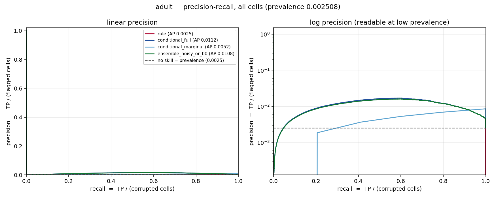
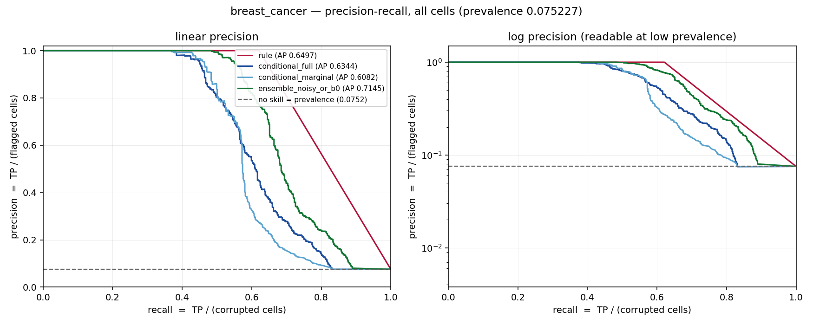
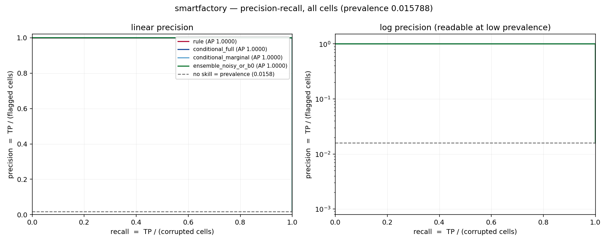

# W4.2 — what the detection numbers actually mean

Generated by `experiments/w4_metrics.py`. **Do not edit by hand.**
Formal definitions of every metric below: **`docs/metrics_definitions.md`**.

This file answers reviewer gap **G1** (`docs/research_program.md` §9): the
report quoted `0.0025 → 0.0120 → 0.70` without saying what the metric was, and
at 0.25 % prevalence a detector can look fine while missing almost everything.

## How to read these numbers

1. **The metric is PR-AUC = average precision**, `AP = Σ(Rₙ − Rₙ₋₁)·Pₙ`, over
   **cells**. Not accuracy, not F1, not AUROC.
2. **A random or constant scorer scores PR-AUC = prevalence.** So prevalence is
   printed in every table, the `PR-AUC / prevalence` column is the lift over
   chance, and the dashed line on every figure is the no-skill baseline. Adult's
   **0.0025 is the floor, not a score.**
3. **PR-AUC is not comparable across datasets.** 0.0120 on adult (prevalence
   0.0025) is 4.8× chance; 0.67 on breast_cancer (prevalence 0.0752) is 8.9×.
   The raw numbers order these the other way round.
4. **best-F1 is an ORACLE threshold** — chosen knowing the labels. It is an
   upper bound, not an operating point, which is why the threshold it uses is
   printed beside it and a full operating-point ladder is given in §5. On adult
   the rule detector's F1-maximising threshold is its *minimum* score: the best
   possible use of that detector is to ignore it and flag every cell.
5. **Accuracy is in these tables only to be dismissed.** Compare any
   `accuracy @best-F1` with the `accuracy if flagging nothing` column beside
   it. On adult a detector that flags nothing is 99.749 % accurate and finds
   0 of 1,701 corruptions.
6. **`—` means undefined, never 0.0** (precision with no flags, ROC-AUC with
   one class, PR-AUC with no positives).
7. **Three operating points** are reported, because one would mislead: the
   detector's own flag set (`s > 0`), an equal review budget (top-k with
   k = number of corrupted cells), and the oracle best-F1 threshold.

## Protocol

- **Unit:** one cell. A cell is corrupted iff its dirty value differs from the
  clean value under `ValueComparator` (`src/detection_eval/labels.py`).
- **Splits:** 5 stratified cell splits, seed 42, 30 % eval each; 95 % percentile
  bootstrap CI over splits via `src.experiments.aggregate.bootstrap_interval`.
  The CI measures split variance only.
- **Whole-dataset tables** (per-column, false positives, operating points, PR
  curves) are computed on **all** cells at the full-set threshold, so the
  counts add up to the dataset totals. This is legitimate here because none of
  the four detectors fits on labels and the conditional scores are produced
  out of fold over rows (5 folds), so the harness reports
  `full_is_in_sample = False` for all of them.
- **Leakage:** `clean_df` is read only for labels and stratification. No
  detector receives a label. Oracle thresholds are evaluation constructs
  applied after scoring and are labelled oracle everywhere.
- Seed 42, deterministic.

## The four detectors

| detector | labels used | score |
|---|---|---|
| `rule` | none | the six Phase-3 rules' `detection_score` (the shipped baseline; IQR fences off on smartfactory, as shipped) |
| `conditional_full` | none | `1 − P(value │ rest of row)`, per-column gradient-boosted models fitted on the dirty table, scored out of fold over rows |
| `conditional_marginal` | none | `1 − P(value)` — the rarity control, which isolates whether *conditioning* is what helps |
| `ensemble_noisy_or_b0` | none | `1 − (1 − rule)(1 − conditional)` at zero labels |

- splits: 3 stratified cell splits, seed 42, 30 % eval each
- total runtime 2954.8s

## 1. Headline table

### adult

678,330 cells, 1,701 corrupted, prevalence 0.002508 (0.251 %), 45,222 rows x 15 columns

| detector | prevalence | PR-AUC [95% CI] | PR-AUC / prevalence | ROC-AUC | best-F1 (oracle) | its threshold | P@k | R@k | accuracy @best-F1 | accuracy if flagging nothing | distinct scores |
|---|---:|---:|---:|---:|---:|---:|---:|---:|---:|---:|---:|
| `rule` | 0.002508 | 0.0025 [0.0025, 0.0025] | 1.0x | 0.4956 [0.4956, 0.4957] | 0.0050 | 0.000000 | 0.0000 | 0.0000 | 0.002508 | 0.997492 | 169 |
| `conditional_full` | 0.002508 | 0.0109 [0.0107, 0.0112] | 4.4x | 0.8768 [0.8740, 0.8803] | 0.0329 | 0.886885 | 0.0000 | 0.0000 | 0.911633 | 0.997492 | 551,866 |
| `conditional_marginal` | 0.002508 | 0.0052 [0.0052, 0.0052] | 2.1x | 0.7160 [0.7150, 0.7167] | 0.0169 | 0.714002 | 0.0000 | 0.0000 | 0.708609 | 0.997492 | 39,789 |
| `ensemble_noisy_or_b0` | 0.002508 | 0.0105 [0.0103, 0.0107] | 4.2x | 0.8739 [0.8711, 0.8774] | 0.0312 | 0.886885 | 0.0000 | 0.0000 | 0.906522 | 0.997492 | 551,866 |

Feature-build notes:

- conditional features scored out of fold (5 folds)

### breast_cancer

8,388 cells, 631 corrupted, prevalence 0.075227 (7.523 %), 699 rows x 12 columns

| detector | prevalence | PR-AUC [95% CI] | PR-AUC / prevalence | ROC-AUC | best-F1 (oracle) | its threshold | P@k | R@k | accuracy @best-F1 | accuracy if flagging nothing | distinct scores |
|---|---:|---:|---:|---:|---:|---:|---:|---:|---:|---:|---:|
| `rule` | 0.075227 | 0.6836 [0.6672, 0.7064] | 9.1x | 0.8289 [0.8201, 0.8413] | 0.7664 | 0.700000 | 0.6326 | 0.6326 | 0.971507 | 0.924773 | 5 |
| `conditional_full` | 0.075227 | 0.6408 [0.6378, 0.6465] | 8.5x | 0.7923 [0.7809, 0.8049] | 0.6240 | 0.999991 | 0.5800 | 0.5800 | 0.953028 | 0.924773 | 6,179 |
| `conditional_marginal` | 0.075227 | 0.6247 [0.6183, 0.6345] | 8.3x | 0.7608 [0.7444, 0.7740] | 0.6313 | 0.989267 | 0.5721 | 0.5721 | 0.956128 | 0.924773 | 394 |
| `ensemble_noisy_or_b0` | 0.075227 | 0.7325 [0.7208, 0.7430] | 9.7x | 0.8585 [0.8517, 0.8619] | 0.7045 | 0.999998 | 0.6513 | 0.6513 | 0.963996 | 0.924773 | 6,179 |

Feature-build notes:

- conditional features scored out of fold (5 folds)

### smartfactory

449,255 cells, 7,093 corrupted, prevalence 0.015788 (1.579 %), 23,645 rows x 19 columns

| detector | prevalence | PR-AUC [95% CI] | PR-AUC / prevalence | ROC-AUC | best-F1 (oracle) | its threshold | P@k | R@k | accuracy @best-F1 | accuracy if flagging nothing | distinct scores |
|---|---:|---:|---:|---:|---:|---:|---:|---:|---:|---:|---:|
| `rule` | 0.015788 | 1.0000 [1.0000, 1.0000] | 63.3x | 1.0000 [1.0000, 1.0000] | 1.0000 | 1.000000 | 1.0000 | 1.0000 | 1.000000 | 0.984212 | 2 |
| `conditional_full` | 0.015788 | 1.0000 [1.0000, 1.0000] | 63.3x | 1.0000 [1.0000, 1.0000] | 1.0000 | 1.000000 | 1.0000 | 1.0000 | 1.000000 | 0.984212 | 249,860 |
| `conditional_marginal` | 0.015788 | 1.0000 [1.0000, 1.0000] | 63.3x | 1.0000 [1.0000, 1.0000] | 1.0000 | 1.000000 | 1.0000 | 1.0000 | 1.000000 | 0.984212 | 24,171 |
| `ensemble_noisy_or_b0` | 0.015788 | 1.0000 [1.0000, 1.0000] | 63.3x | 1.0000 [1.0000, 1.0000] | 1.0000 | 1.000000 | 1.0000 | 1.0000 | 1.000000 | 0.984212 | 249,860 |

Feature-build notes:

- conditional features scored out of fold (5 folds)

`P@k` and `R@k` use k = number of corrupted cells, so they are equal by construction (both are TP/k with k = P); both are printed because both names appear in the literature. They are the R-precision.

## 2. Precision-recall curves

### adult

All 678,330 cells, all four detectors overlaid. The dashed line is precision = prevalence = 0.002508, the no-skill baseline; a curve on that line carries no information and area below it is worse than chance. The right panel is the same data with precision on a log axis, because at adult's prevalence every curve otherwise lies on the x-axis. Curves are drawn with at most 50,000 points (stride-subsampled for file size); every AP in the legend is computed on the full curve and is asserted equal to the library's `pr_auc` (§6).

### breast_cancer

All 8,388 cells, all four detectors overlaid. The dashed line is precision = prevalence = 0.075227, the no-skill baseline; a curve on that line carries no information and area below it is worse than chance. The right panel is the same data with precision on a log axis, because at adult's prevalence every curve otherwise lies on the x-axis. Curves are drawn with at most 50,000 points (stride-subsampled for file size); every AP in the legend is computed on the full curve and is asserted equal to the library's `pr_auc` (§6).

### smartfactory

All 449,255 cells, all four detectors overlaid. The dashed line is precision = prevalence = 0.015788, the no-skill baseline; a curve on that line carries no information and area below it is worse than chance. The right panel is the same data with precision on a log axis, because at adult's prevalence every curve otherwise lies on the x-axis. Curves are drawn with at most 50,000 points (stride-subsampled for file size); every AP in the legend is computed on the full curve and is asserted equal to the library's `pr_auc` (§6).

## 3. Per-column precision and recall

The reviewer's specific ask. `@oracle` = at the detector's own best-F1 threshold (label-chosen, an upper bound). `@budget` = flagging the top k cells of the whole-table ranking, k = number of corrupted cells, ties broken by a seeded permutation. `PR-AUC within column` ranks only that column's cells and is `—` where the column has no corruption.

### adult

#### `rule`

Oracle threshold 0.000000 flags 678,330 cells in total; the equal-budget point flags the top 1,701.

| column | cells | corrupted | PR-AUC within column | flags @oracle | TP @oracle | precision @oracle | recall @oracle | flags @budget | TP @budget | precision @budget | recall @budget |
|---|---:|---:|---:|---:|---:|---:|---:|---:|---:|---:|---:|
| `income` | 45,222 | 1,701 | 0.0376 | 45,222 | 1,701 | 0.0376 | 1.0000 | 0 | 0 | — | 0.0000 |
| `hours_per_week` | 45,222 | 0 | — | 45,222 | 0 | 0.0000 | — | 1,674 | 0 | 0.0000 | — |
| `fnlwgt` | 45,222 | 0 | — | 45,222 | 0 | 0.0000 | — | 27 | 0 | 0.0000 | — |
| `age` | 45,222 | 0 | — | 45,222 | 0 | 0.0000 | — | 0 | 0 | — | — |
| `capital_gain` | 45,222 | 0 | — | 45,222 | 0 | 0.0000 | — | 0 | 0 | — | — |
| `capital_loss` | 45,222 | 0 | — | 45,222 | 0 | 0.0000 | — | 0 | 0 | — | — |
| `education` | 45,222 | 0 | — | 45,222 | 0 | 0.0000 | — | 0 | 0 | — | — |
| `educational_num` | 45,222 | 0 | — | 45,222 | 0 | 0.0000 | — | 0 | 0 | — | — |
| `gender` | 45,222 | 0 | — | 45,222 | 0 | 0.0000 | — | 0 | 0 | — | — |
| `marital_status` | 45,222 | 0 | — | 45,222 | 0 | 0.0000 | — | 0 | 0 | — | — |
| `native_country` | 45,222 | 0 | — | 45,222 | 0 | 0.0000 | — | 0 | 0 | — | — |
| `occupation` | 45,222 | 0 | — | 45,222 | 0 | 0.0000 | — | 0 | 0 | — | — |
| `race` | 45,222 | 0 | — | 45,222 | 0 | 0.0000 | — | 0 | 0 | — | — |
| `relationship` | 45,222 | 0 | — | 45,222 | 0 | 0.0000 | — | 0 | 0 | — | — |
| `workclass` | 45,222 | 0 | — | 45,222 | 0 | 0.0000 | — | 0 | 0 | — | — |

#### `conditional_full`

Oracle threshold 0.886885 flags 60,283 cells in total; the equal-budget point flags the top 1,701.

| column | cells | corrupted | PR-AUC within column | flags @oracle | TP @oracle | precision @oracle | recall @oracle | flags @budget | TP @budget | precision @budget | recall @budget |
|---|---:|---:|---:|---:|---:|---:|---:|---:|---:|---:|---:|
| `income` | 45,222 | 1,701 | 0.6813 | 1,350 | 1,021 | 0.7563 | 0.6002 | 0 | 0 | — | 0.0000 |
| `native_country` | 45,222 | 0 | — | 6,896 | 0 | 0.0000 | — | 1,237 | 0 | 0.0000 | — |
| `occupation` | 45,222 | 0 | — | 16,020 | 0 | 0.0000 | — | 406 | 0 | 0.0000 | — |
| `workclass` | 45,222 | 0 | — | 6,512 | 0 | 0.0000 | — | 33 | 0 | 0.0000 | — |
| `marital_status` | 45,222 | 0 | — | 2,907 | 0 | 0.0000 | — | 23 | 0 | 0.0000 | — |
| `gender` | 45,222 | 0 | — | 425 | 0 | 0.0000 | — | 2 | 0 | 0.0000 | — |
| `age` | 45,222 | 0 | — | 39 | 0 | 0.0000 | — | 0 | 0 | — | — |
| `capital_gain` | 45,222 | 0 | — | 14,803 | 0 | 0.0000 | — | 0 | 0 | — | — |
| `capital_loss` | 45,222 | 0 | — | 5,418 | 0 | 0.0000 | — | 0 | 0 | — | — |
| `education` | 45,222 | 0 | — | 0 | 0 | — | — | 0 | 0 | — | — |
| `educational_num` | 45,222 | 0 | — | 0 | 0 | — | — | 0 | 0 | — | — |
| `fnlwgt` | 45,222 | 0 | — | 122 | 0 | 0.0000 | — | 0 | 0 | — | — |
| `hours_per_week` | 45,222 | 0 | — | 597 | 0 | 0.0000 | — | 0 | 0 | — | — |
| `race` | 45,222 | 0 | — | 2,599 | 0 | 0.0000 | — | 0 | 0 | — | — |
| `relationship` | 45,222 | 0 | — | 2,595 | 0 | 0.0000 | — | 0 | 0 | — | — |

#### `conditional_marginal`

Oracle threshold 0.714002 flags 199,360 cells in total; the equal-budget point flags the top 1,701.

| column | cells | corrupted | PR-AUC within column | flags @oracle | TP @oracle | precision @oracle | recall @oracle | flags @budget | TP @budget | precision @budget | recall @budget |
|---|---:|---:|---:|---:|---:|---:|---:|---:|---:|---:|---:|
| `income` | 45,222 | 1,701 | 0.1328 | 12,909 | 1,701 | 0.1318 | 1.0000 | 0 | 0 | — | 0.0000 |
| `native_country` | 45,222 | 0 | — | 3,930 | 0 | 0.0000 | — | 1,490 | 0 | 0.0000 | — |
| `education` | 45,222 | 0 | — | 30,439 | 0 | 0.0000 | — | 72 | 0 | 0.0000 | — |
| `educational_num` | 45,222 | 0 | — | 30,439 | 0 | 0.0000 | — | 72 | 0 | 0.0000 | — |
| `marital_status` | 45,222 | 0 | — | 9,569 | 0 | 0.0000 | — | 32 | 0 | 0.0000 | — |
| `workclass` | 45,222 | 0 | — | 11,915 | 0 | 0.0000 | — | 21 | 0 | 0.0000 | — |
| `occupation` | 45,222 | 0 | — | 45,222 | 0 | 0.0000 | — | 14 | 0 | 0.0000 | — |
| `age` | 45,222 | 0 | — | 984 | 0 | 0.0000 | — | 0 | 0 | — | — |
| `capital_gain` | 45,222 | 0 | — | 365 | 0 | 0.0000 | — | 0 | 0 | — | — |
| `capital_loss` | 45,222 | 0 | — | 2,105 | 0 | 0.0000 | — | 0 | 0 | — | — |
| `fnlwgt` | 45,222 | 0 | — | 2,778 | 0 | 0.0000 | — | 0 | 0 | — | — |
| `gender` | 45,222 | 0 | — | 0 | 0 | — | — | 0 | 0 | — | — |
| `hours_per_week` | 45,222 | 0 | — | 15,830 | 0 | 0.0000 | — | 0 | 0 | — | — |
| `race` | 45,222 | 0 | — | 6,319 | 0 | 0.0000 | — | 0 | 0 | — | — |
| `relationship` | 45,222 | 0 | — | 26,556 | 0 | 0.0000 | — | 0 | 0 | — | — |

#### `ensemble_noisy_or_b0`

Oracle threshold 0.886885 flags 63,750 cells in total; the equal-budget point flags the top 1,701.

| column | cells | corrupted | PR-AUC within column | flags @oracle | TP @oracle | precision @oracle | recall @oracle | flags @budget | TP @budget | precision @budget | recall @budget |
|---|---:|---:|---:|---:|---:|---:|---:|---:|---:|---:|---:|
| `income` | 45,222 | 1,701 | 0.6813 | 1,350 | 1,021 | 0.7563 | 0.6002 | 0 | 0 | — | 0.0000 |
| `native_country` | 45,222 | 0 | — | 6,896 | 0 | 0.0000 | — | 1,237 | 0 | 0.0000 | — |
| `occupation` | 45,222 | 0 | — | 16,020 | 0 | 0.0000 | — | 406 | 0 | 0.0000 | — |
| `workclass` | 45,222 | 0 | — | 6,512 | 0 | 0.0000 | — | 33 | 0 | 0.0000 | — |
| `marital_status` | 45,222 | 0 | — | 2,907 | 0 | 0.0000 | — | 23 | 0 | 0.0000 | — |
| `gender` | 45,222 | 0 | — | 425 | 0 | 0.0000 | — | 2 | 0 | 0.0000 | — |
| `age` | 45,222 | 0 | — | 39 | 0 | 0.0000 | — | 0 | 0 | — | — |
| `capital_gain` | 45,222 | 0 | — | 14,803 | 0 | 0.0000 | — | 0 | 0 | — | — |
| `capital_loss` | 45,222 | 0 | — | 5,418 | 0 | 0.0000 | — | 0 | 0 | — | — |
| `education` | 45,222 | 0 | — | 0 | 0 | — | — | 0 | 0 | — | — |
| `educational_num` | 45,222 | 0 | — | 0 | 0 | — | — | 0 | 0 | — | — |
| `fnlwgt` | 45,222 | 0 | — | 203 | 0 | 0.0000 | — | 0 | 0 | — | — |
| `hours_per_week` | 45,222 | 0 | — | 3,983 | 0 | 0.0000 | — | 0 | 0 | — | — |
| `race` | 45,222 | 0 | — | 2,599 | 0 | 0.0000 | — | 0 | 0 | — | — |
| `relationship` | 45,222 | 0 | — | 2,595 | 0 | 0.0000 | — | 0 | 0 | — | — |

### breast_cancer

#### `rule`

Oracle threshold 0.700000 flags 392 cells in total; the equal-budget point flags the top 631.

| column | cells | corrupted | PR-AUC within column | flags @oracle | TP @oracle | precision @oracle | recall @oracle | flags @budget | TP @budget | precision @budget | recall @budget |
|---|---:|---:|---:|---:|---:|---:|---:|---:|---:|---:|---:|
| `Clump Thickness` | 699 | 73 | 0.6810 | 47 | 47 | 1.0000 | 0.6438 | 64 | 48 | 0.7500 | 0.6575 |
| `Normal Nucleoli` | 699 | 63 | 0.6967 | 42 | 42 | 1.0000 | 0.6667 | 67 | 42 | 0.6269 | 0.6667 |
| `Single Epithelial Cell Size` | 699 | 61 | 0.7157 | 42 | 42 | 1.0000 | 0.6885 | 67 | 42 | 0.6269 | 0.6885 |
| `Bland Chromatin` | 699 | 61 | 0.7007 | 41 | 41 | 1.0000 | 0.6721 | 63 | 41 | 0.6508 | 0.6721 |
| `Sample code number` | 699 | 60 | 0.3601 | 18 | 18 | 1.0000 | 0.3000 | 35 | 19 | 0.5429 | 0.3167 |
| `Uniformity of Cell Shape` | 699 | 55 | 0.6650 | 35 | 35 | 1.0000 | 0.6364 | 55 | 35 | 0.6364 | 0.6364 |
| `Uniformity of Cell Size` | 699 | 53 | 0.7384 | 38 | 38 | 1.0000 | 0.7170 | 58 | 38 | 0.6552 | 0.7170 |
| `Marginal Adhesion` | 699 | 51 | 0.7819 | 39 | 39 | 1.0000 | 0.7647 | 62 | 39 | 0.6290 | 0.7647 |
| `Bare Nuclei` | 699 | 50 | 0.7400 | 36 | 36 | 1.0000 | 0.7200 | 49 | 36 | 0.7347 | 0.7200 |
| `Unnamed: 0` | 699 | 47 | 0.4443 | 19 | 19 | 1.0000 | 0.4043 | 39 | 20 | 0.5128 | 0.4255 |
| `Mitoses` | 699 | 42 | 0.8433 | 35 | 35 | 1.0000 | 0.8333 | 52 | 35 | 0.6731 | 0.8333 |
| `class` | 699 | 15 | 0.0215 | 0 | 0 | — | 0.0000 | 20 | 0 | 0.0000 | 0.0000 |

#### `conditional_full`

Oracle threshold 0.999991 flags 417 cells in total; the equal-budget point flags the top 631.

| column | cells | corrupted | PR-AUC within column | flags @oracle | TP @oracle | precision @oracle | recall @oracle | flags @budget | TP @budget | precision @budget | recall @budget |
|---|---:|---:|---:|---:|---:|---:|---:|---:|---:|---:|---:|
| `Clump Thickness` | 699 | 73 | 0.7324 | 46 | 41 | 0.8913 | 0.5616 | 70 | 46 | 0.6571 | 0.6301 |
| `Normal Nucleoli` | 699 | 63 | 0.7604 | 51 | 41 | 0.8039 | 0.6508 | 76 | 45 | 0.5921 | 0.7143 |
| `Single Epithelial Cell Size` | 699 | 61 | 0.7801 | 47 | 40 | 0.8511 | 0.6557 | 70 | 45 | 0.6429 | 0.7377 |
| `Bland Chromatin` | 699 | 61 | 0.8026 | 48 | 42 | 0.8750 | 0.6885 | 64 | 46 | 0.7188 | 0.7541 |
| `Sample code number` | 699 | 60 | 0.0858 | 0 | 0 | — | 0.0000 | 0 | 0 | — | 0.0000 |
| `Uniformity of Cell Shape` | 699 | 55 | 0.7727 | 40 | 34 | 0.8500 | 0.6182 | 60 | 39 | 0.6500 | 0.7091 |
| `Uniformity of Cell Size` | 699 | 53 | 0.8501 | 43 | 39 | 0.9070 | 0.7358 | 62 | 43 | 0.6935 | 0.8113 |
| `Marginal Adhesion` | 699 | 51 | 0.6495 | 37 | 26 | 0.7027 | 0.5098 | 60 | 31 | 0.5167 | 0.6078 |
| `Bare Nuclei` | 699 | 50 | 0.7530 | 54 | 34 | 0.6296 | 0.6800 | 96 | 36 | 0.3750 | 0.7200 |
| `Unnamed: 0` | 699 | 47 | 0.0672 | 0 | 0 | — | 0.0000 | 0 | 0 | — | 0.0000 |
| `Mitoses` | 699 | 42 | 0.7829 | 51 | 30 | 0.5882 | 0.7143 | 73 | 35 | 0.4795 | 0.8333 |
| `class` | 699 | 15 | 0.6871 | 0 | 0 | — | 0.0000 | 0 | 0 | — | 0.0000 |

#### `conditional_marginal`

Oracle threshold 0.989267 flags 367 cells in total; the equal-budget point flags the top 631.

| column | cells | corrupted | PR-AUC within column | flags @oracle | TP @oracle | precision @oracle | recall @oracle | flags @budget | TP @budget | precision @budget | recall @budget |
|---|---:|---:|---:|---:|---:|---:|---:|---:|---:|---:|---:|
| `Clump Thickness` | 699 | 73 | 0.7300 | 47 | 47 | 1.0000 | 0.6438 | 59 | 47 | 0.7966 | 0.6438 |
| `Normal Nucleoli` | 699 | 63 | 0.7381 | 32 | 32 | 1.0000 | 0.5079 | 107 | 43 | 0.4019 | 0.6825 |
| `Bland Chromatin` | 699 | 61 | 0.7591 | 41 | 41 | 1.0000 | 0.6721 | 72 | 43 | 0.5972 | 0.7049 |
| `Single Epithelial Cell Size` | 699 | 61 | 0.7208 | 44 | 38 | 0.8636 | 0.6230 | 64 | 43 | 0.6719 | 0.7049 |
| `Sample code number` | 699 | 60 | 0.0858 | 0 | 0 | — | 0.0000 | 0 | 0 | — | 0.0000 |
| `Uniformity of Cell Shape` | 699 | 55 | 0.6923 | 39 | 34 | 0.8718 | 0.6182 | 42 | 35 | 0.8333 | 0.6364 |
| `Uniformity of Cell Size` | 699 | 53 | 0.7590 | 43 | 38 | 0.8837 | 0.7170 | 58 | 38 | 0.6552 | 0.7170 |
| `Marginal Adhesion` | 699 | 51 | 0.7249 | 31 | 26 | 0.8387 | 0.5098 | 54 | 39 | 0.7222 | 0.7647 |
| `Bare Nuclei` | 699 | 50 | 0.7419 | 47 | 36 | 0.7660 | 0.7200 | 90 | 36 | 0.4000 | 0.7200 |
| `Unnamed: 0` | 699 | 47 | 0.0672 | 0 | 0 | — | 0.0000 | 0 | 0 | — | 0.0000 |
| `Mitoses` | 699 | 42 | 0.7241 | 43 | 23 | 0.5349 | 0.5476 | 85 | 37 | 0.4353 | 0.8810 |
| `class` | 699 | 15 | 0.0280 | 0 | 0 | — | 0.0000 | 0 | 0 | — | 0.0000 |

#### `ensemble_noisy_or_b0`

Oracle threshold 0.999998 flags 391 cells in total; the equal-budget point flags the top 631.

| column | cells | corrupted | PR-AUC within column | flags @oracle | TP @oracle | precision @oracle | recall @oracle | flags @budget | TP @budget | precision @budget | recall @budget |
|---|---:|---:|---:|---:|---:|---:|---:|---:|---:|---:|---:|
| `Clump Thickness` | 699 | 73 | 0.7548 | 43 | 42 | 0.9767 | 0.5753 | 69 | 49 | 0.7101 | 0.6712 |
| `Normal Nucleoli` | 699 | 63 | 0.7814 | 42 | 40 | 0.9524 | 0.6349 | 71 | 46 | 0.6479 | 0.7302 |
| `Bland Chromatin` | 699 | 61 | 0.8175 | 44 | 40 | 0.9091 | 0.6557 | 64 | 47 | 0.7344 | 0.7705 |
| `Single Epithelial Cell Size` | 699 | 61 | 0.8044 | 40 | 40 | 1.0000 | 0.6557 | 64 | 45 | 0.7031 | 0.7377 |
| `Sample code number` | 699 | 60 | 0.3601 | 18 | 18 | 1.0000 | 0.3000 | 18 | 18 | 1.0000 | 0.3000 |
| `Uniformity of Cell Shape` | 699 | 55 | 0.7917 | 35 | 33 | 0.9429 | 0.6000 | 53 | 39 | 0.7358 | 0.7091 |
| `Uniformity of Cell Size` | 699 | 53 | 0.8518 | 39 | 39 | 1.0000 | 0.7358 | 55 | 43 | 0.7818 | 0.8113 |
| `Marginal Adhesion` | 699 | 51 | 0.6989 | 32 | 28 | 0.8750 | 0.5490 | 58 | 32 | 0.5517 | 0.6275 |
| `Bare Nuclei` | 699 | 50 | 0.7669 | 41 | 33 | 0.8049 | 0.6600 | 87 | 36 | 0.4138 | 0.7200 |
| `Unnamed: 0` | 699 | 47 | 0.4443 | 19 | 19 | 1.0000 | 0.4043 | 19 | 19 | 1.0000 | 0.4043 |
| `Mitoses` | 699 | 42 | 0.8279 | 38 | 28 | 0.7368 | 0.6667 | 73 | 37 | 0.5068 | 0.8810 |
| `class` | 699 | 15 | 0.6871 | 0 | 0 | — | 0.0000 | 0 | 0 | — | 0.0000 |

### smartfactory

#### `rule`

Oracle threshold 1.000000 flags 7,093 cells in total; the equal-budget point flags the top 7,093.

| column | cells | corrupted | PR-AUC within column | flags @oracle | TP @oracle | precision @oracle | recall @oracle | flags @budget | TP @budget | precision @budget | recall @budget |
|---|---:|---:|---:|---:|---:|---:|---:|---:|---:|---:|---:|
| `o_w_hl_power` | 23,645 | 429 | 1.0000 | 429 | 429 | 1.0000 | 1.0000 | 429 | 429 | 1.0000 | 1.0000 |
| `o_w_bhl_power` | 23,645 | 413 | 1.0000 | 413 | 413 | 1.0000 | 1.0000 | 413 | 413 | 1.0000 | 1.0000 |
| `o_w_bru_voltage` | 23,645 | 413 | 1.0000 | 413 | 413 | 1.0000 | 1.0000 | 413 | 413 | 1.0000 | 1.0000 |
| `o_w_bru_power` | 23,645 | 409 | 1.0000 | 409 | 409 | 1.0000 | 1.0000 | 409 | 409 | 1.0000 | 1.0000 |
| `o_w_bhl_voltage` | 23,645 | 404 | 1.0000 | 404 | 404 | 1.0000 | 1.0000 | 404 | 404 | 1.0000 | 1.0000 |
| `i_w_hl_weg` | 23,645 | 402 | 1.0000 | 402 | 402 | 1.0000 | 1.0000 | 402 | 402 | 1.0000 | 1.0000 |
| `o_w_blo_power` | 23,645 | 398 | 1.0000 | 398 | 398 | 1.0000 | 1.0000 | 398 | 398 | 1.0000 | 1.0000 |
| `o_w_hr_power` | 23,645 | 398 | 1.0000 | 398 | 398 | 1.0000 | 1.0000 | 398 | 398 | 1.0000 | 1.0000 |
| `o_w_blo_voltage` | 23,645 | 396 | 1.0000 | 396 | 396 | 1.0000 | 1.0000 | 396 | 396 | 1.0000 | 1.0000 |
| `i_w_bru_weg` | 23,645 | 391 | 1.0000 | 391 | 391 | 1.0000 | 1.0000 | 391 | 391 | 1.0000 | 1.0000 |
| `i_w_hr_weg` | 23,645 | 390 | 1.0000 | 390 | 390 | 1.0000 | 1.0000 | 390 | 390 | 1.0000 | 1.0000 |
| `i_w_bhl_weg` | 23,645 | 385 | 1.0000 | 385 | 385 | 1.0000 | 1.0000 | 385 | 385 | 1.0000 | 1.0000 |
| `o_w_hl_voltage` | 23,645 | 382 | 1.0000 | 382 | 382 | 1.0000 | 1.0000 | 382 | 382 | 1.0000 | 1.0000 |
| `o_w_hr_voltage` | 23,645 | 382 | 1.0000 | 382 | 382 | 1.0000 | 1.0000 | 382 | 382 | 1.0000 | 1.0000 |
| `o_w_bhr_voltage` | 23,645 | 381 | 1.0000 | 381 | 381 | 1.0000 | 1.0000 | 381 | 381 | 1.0000 | 1.0000 |
| `o_w_bhr_power` | 23,645 | 378 | 1.0000 | 378 | 378 | 1.0000 | 1.0000 | 378 | 378 | 1.0000 | 1.0000 |
| `i_w_blo_weg` | 23,645 | 374 | 1.0000 | 374 | 374 | 1.0000 | 1.0000 | 374 | 374 | 1.0000 | 1.0000 |
| `i_w_bhr_weg` | 23,645 | 368 | 1.0000 | 368 | 368 | 1.0000 | 1.0000 | 368 | 368 | 1.0000 | 1.0000 |
| `labels` | 23,645 | 0 | — | 0 | 0 | — | — | 0 | 0 | — | — |

#### `conditional_full`

Oracle threshold 1.000000 flags 7,093 cells in total; the equal-budget point flags the top 7,093.

| column | cells | corrupted | PR-AUC within column | flags @oracle | TP @oracle | precision @oracle | recall @oracle | flags @budget | TP @budget | precision @budget | recall @budget |
|---|---:|---:|---:|---:|---:|---:|---:|---:|---:|---:|---:|
| `o_w_hl_power` | 23,645 | 429 | 1.0000 | 429 | 429 | 1.0000 | 1.0000 | 429 | 429 | 1.0000 | 1.0000 |
| `o_w_bhl_power` | 23,645 | 413 | 1.0000 | 413 | 413 | 1.0000 | 1.0000 | 413 | 413 | 1.0000 | 1.0000 |
| `o_w_bru_voltage` | 23,645 | 413 | 1.0000 | 413 | 413 | 1.0000 | 1.0000 | 413 | 413 | 1.0000 | 1.0000 |
| `o_w_bru_power` | 23,645 | 409 | 1.0000 | 409 | 409 | 1.0000 | 1.0000 | 409 | 409 | 1.0000 | 1.0000 |
| `o_w_bhl_voltage` | 23,645 | 404 | 1.0000 | 404 | 404 | 1.0000 | 1.0000 | 404 | 404 | 1.0000 | 1.0000 |
| `i_w_hl_weg` | 23,645 | 402 | 1.0000 | 402 | 402 | 1.0000 | 1.0000 | 402 | 402 | 1.0000 | 1.0000 |
| `o_w_blo_power` | 23,645 | 398 | 1.0000 | 398 | 398 | 1.0000 | 1.0000 | 398 | 398 | 1.0000 | 1.0000 |
| `o_w_hr_power` | 23,645 | 398 | 1.0000 | 398 | 398 | 1.0000 | 1.0000 | 398 | 398 | 1.0000 | 1.0000 |
| `o_w_blo_voltage` | 23,645 | 396 | 1.0000 | 396 | 396 | 1.0000 | 1.0000 | 396 | 396 | 1.0000 | 1.0000 |
| `i_w_bru_weg` | 23,645 | 391 | 1.0000 | 391 | 391 | 1.0000 | 1.0000 | 391 | 391 | 1.0000 | 1.0000 |
| `i_w_hr_weg` | 23,645 | 390 | 1.0000 | 390 | 390 | 1.0000 | 1.0000 | 390 | 390 | 1.0000 | 1.0000 |
| `i_w_bhl_weg` | 23,645 | 385 | 1.0000 | 385 | 385 | 1.0000 | 1.0000 | 385 | 385 | 1.0000 | 1.0000 |
| `o_w_hl_voltage` | 23,645 | 382 | 1.0000 | 382 | 382 | 1.0000 | 1.0000 | 382 | 382 | 1.0000 | 1.0000 |
| `o_w_hr_voltage` | 23,645 | 382 | 1.0000 | 382 | 382 | 1.0000 | 1.0000 | 382 | 382 | 1.0000 | 1.0000 |
| `o_w_bhr_voltage` | 23,645 | 381 | 1.0000 | 381 | 381 | 1.0000 | 1.0000 | 381 | 381 | 1.0000 | 1.0000 |
| `o_w_bhr_power` | 23,645 | 378 | 1.0000 | 378 | 378 | 1.0000 | 1.0000 | 378 | 378 | 1.0000 | 1.0000 |
| `i_w_blo_weg` | 23,645 | 374 | 1.0000 | 374 | 374 | 1.0000 | 1.0000 | 374 | 374 | 1.0000 | 1.0000 |
| `i_w_bhr_weg` | 23,645 | 368 | 1.0000 | 368 | 368 | 1.0000 | 1.0000 | 368 | 368 | 1.0000 | 1.0000 |
| `labels` | 23,645 | 0 | — | 0 | 0 | — | — | 0 | 0 | — | — |

#### `conditional_marginal`

Oracle threshold 1.000000 flags 7,093 cells in total; the equal-budget point flags the top 7,093.

| column | cells | corrupted | PR-AUC within column | flags @oracle | TP @oracle | precision @oracle | recall @oracle | flags @budget | TP @budget | precision @budget | recall @budget |
|---|---:|---:|---:|---:|---:|---:|---:|---:|---:|---:|---:|
| `o_w_hl_power` | 23,645 | 429 | 1.0000 | 429 | 429 | 1.0000 | 1.0000 | 429 | 429 | 1.0000 | 1.0000 |
| `o_w_bhl_power` | 23,645 | 413 | 1.0000 | 413 | 413 | 1.0000 | 1.0000 | 413 | 413 | 1.0000 | 1.0000 |
| `o_w_bru_voltage` | 23,645 | 413 | 1.0000 | 413 | 413 | 1.0000 | 1.0000 | 413 | 413 | 1.0000 | 1.0000 |
| `o_w_bru_power` | 23,645 | 409 | 1.0000 | 409 | 409 | 1.0000 | 1.0000 | 409 | 409 | 1.0000 | 1.0000 |
| `o_w_bhl_voltage` | 23,645 | 404 | 1.0000 | 404 | 404 | 1.0000 | 1.0000 | 404 | 404 | 1.0000 | 1.0000 |
| `i_w_hl_weg` | 23,645 | 402 | 1.0000 | 402 | 402 | 1.0000 | 1.0000 | 402 | 402 | 1.0000 | 1.0000 |
| `o_w_blo_power` | 23,645 | 398 | 1.0000 | 398 | 398 | 1.0000 | 1.0000 | 398 | 398 | 1.0000 | 1.0000 |
| `o_w_hr_power` | 23,645 | 398 | 1.0000 | 398 | 398 | 1.0000 | 1.0000 | 398 | 398 | 1.0000 | 1.0000 |
| `o_w_blo_voltage` | 23,645 | 396 | 1.0000 | 396 | 396 | 1.0000 | 1.0000 | 396 | 396 | 1.0000 | 1.0000 |
| `i_w_bru_weg` | 23,645 | 391 | 1.0000 | 391 | 391 | 1.0000 | 1.0000 | 391 | 391 | 1.0000 | 1.0000 |
| `i_w_hr_weg` | 23,645 | 390 | 1.0000 | 390 | 390 | 1.0000 | 1.0000 | 390 | 390 | 1.0000 | 1.0000 |
| `i_w_bhl_weg` | 23,645 | 385 | 1.0000 | 385 | 385 | 1.0000 | 1.0000 | 385 | 385 | 1.0000 | 1.0000 |
| `o_w_hl_voltage` | 23,645 | 382 | 1.0000 | 382 | 382 | 1.0000 | 1.0000 | 382 | 382 | 1.0000 | 1.0000 |
| `o_w_hr_voltage` | 23,645 | 382 | 1.0000 | 382 | 382 | 1.0000 | 1.0000 | 382 | 382 | 1.0000 | 1.0000 |
| `o_w_bhr_voltage` | 23,645 | 381 | 1.0000 | 381 | 381 | 1.0000 | 1.0000 | 381 | 381 | 1.0000 | 1.0000 |
| `o_w_bhr_power` | 23,645 | 378 | 1.0000 | 378 | 378 | 1.0000 | 1.0000 | 378 | 378 | 1.0000 | 1.0000 |
| `i_w_blo_weg` | 23,645 | 374 | 1.0000 | 374 | 374 | 1.0000 | 1.0000 | 374 | 374 | 1.0000 | 1.0000 |
| `i_w_bhr_weg` | 23,645 | 368 | 1.0000 | 368 | 368 | 1.0000 | 1.0000 | 368 | 368 | 1.0000 | 1.0000 |
| `labels` | 23,645 | 0 | — | 0 | 0 | — | — | 0 | 0 | — | — |

#### `ensemble_noisy_or_b0`

Oracle threshold 1.000000 flags 7,093 cells in total; the equal-budget point flags the top 7,093.

| column | cells | corrupted | PR-AUC within column | flags @oracle | TP @oracle | precision @oracle | recall @oracle | flags @budget | TP @budget | precision @budget | recall @budget |
|---|---:|---:|---:|---:|---:|---:|---:|---:|---:|---:|---:|
| `o_w_hl_power` | 23,645 | 429 | 1.0000 | 429 | 429 | 1.0000 | 1.0000 | 429 | 429 | 1.0000 | 1.0000 |
| `o_w_bhl_power` | 23,645 | 413 | 1.0000 | 413 | 413 | 1.0000 | 1.0000 | 413 | 413 | 1.0000 | 1.0000 |
| `o_w_bru_voltage` | 23,645 | 413 | 1.0000 | 413 | 413 | 1.0000 | 1.0000 | 413 | 413 | 1.0000 | 1.0000 |
| `o_w_bru_power` | 23,645 | 409 | 1.0000 | 409 | 409 | 1.0000 | 1.0000 | 409 | 409 | 1.0000 | 1.0000 |
| `o_w_bhl_voltage` | 23,645 | 404 | 1.0000 | 404 | 404 | 1.0000 | 1.0000 | 404 | 404 | 1.0000 | 1.0000 |
| `i_w_hl_weg` | 23,645 | 402 | 1.0000 | 402 | 402 | 1.0000 | 1.0000 | 402 | 402 | 1.0000 | 1.0000 |
| `o_w_blo_power` | 23,645 | 398 | 1.0000 | 398 | 398 | 1.0000 | 1.0000 | 398 | 398 | 1.0000 | 1.0000 |
| `o_w_hr_power` | 23,645 | 398 | 1.0000 | 398 | 398 | 1.0000 | 1.0000 | 398 | 398 | 1.0000 | 1.0000 |
| `o_w_blo_voltage` | 23,645 | 396 | 1.0000 | 396 | 396 | 1.0000 | 1.0000 | 396 | 396 | 1.0000 | 1.0000 |
| `i_w_bru_weg` | 23,645 | 391 | 1.0000 | 391 | 391 | 1.0000 | 1.0000 | 391 | 391 | 1.0000 | 1.0000 |
| `i_w_hr_weg` | 23,645 | 390 | 1.0000 | 390 | 390 | 1.0000 | 1.0000 | 390 | 390 | 1.0000 | 1.0000 |
| `i_w_bhl_weg` | 23,645 | 385 | 1.0000 | 385 | 385 | 1.0000 | 1.0000 | 385 | 385 | 1.0000 | 1.0000 |
| `o_w_hl_voltage` | 23,645 | 382 | 1.0000 | 382 | 382 | 1.0000 | 1.0000 | 382 | 382 | 1.0000 | 1.0000 |
| `o_w_hr_voltage` | 23,645 | 382 | 1.0000 | 382 | 382 | 1.0000 | 1.0000 | 382 | 382 | 1.0000 | 1.0000 |
| `o_w_bhr_voltage` | 23,645 | 381 | 1.0000 | 381 | 381 | 1.0000 | 1.0000 | 381 | 381 | 1.0000 | 1.0000 |
| `o_w_bhr_power` | 23,645 | 378 | 1.0000 | 378 | 378 | 1.0000 | 1.0000 | 378 | 378 | 1.0000 | 1.0000 |
| `i_w_blo_weg` | 23,645 | 374 | 1.0000 | 374 | 374 | 1.0000 | 1.0000 | 374 | 374 | 1.0000 | 1.0000 |
| `i_w_bhr_weg` | 23,645 | 368 | 1.0000 | 368 | 368 | 1.0000 | 1.0000 | 368 | 368 | 1.0000 | 1.0000 |
| `labels` | 23,645 | 0 | — | 0 | 0 | — | — | 0 | 0 | — | — |

## 4. False-positive accounting

A false positive is a flagged cell whose dirty value **equals** its clean value. Counts are over all cells.

### adult

| detector | operating point | threshold | cells flagged | true positives | **false positives** | FP share of flags | recall | top false-positive columns |
|---|---|---:|---:|---:|---:|---:|---:|---|
| `rule` | s > 0 | 0.450100 | 5,829 | 0 | **5,829** | 100.00 % | 0.0000 | `hours_per_week` 5,626, `fnlwgt` 203 |
| `rule` | top-k (k = 1,701) | — | 1,701 | 0 | **1,701** | 100.00 % | 0.0000 | `hours_per_week` 1,674, `fnlwgt` 27 |
| `rule` | best-F1 (oracle) | 0.000000 | 678,330 | 1,701 | **676,629** | 99.75 % | 1.0000 | `age` 45,222, `capital_gain` 45,222, `capital_loss` 45,222, `education` 45,222, `educational_num` 45,222 |
| `conditional_full` | s > 0 | 0.000000 | 624,812 | 1,701 | **623,111** | 99.73 % | 1.0000 | `age` 45,222, `capital_gain` 45,222, `capital_loss` 45,222, `fnlwgt` 45,222, `hours_per_week` 45,222 |
| `conditional_full` | top-k (k = 1,701) | — | 1,701 | 0 | **1,701** | 100.00 % | 0.0000 | `native_country` 1,237, `occupation` 406, `workclass` 33, `marital_status` 23, `gender` 2 |
| `conditional_full` | best-F1 (oracle) | 0.886885 | 60,283 | 1,021 | **59,262** | 98.31 % | 0.6002 | `occupation` 16,020, `capital_gain` 14,803, `native_country` 6,896, `workclass` 6,512, `capital_loss` 5,418 |
| `conditional_marginal` | s > 0 | 0.000032 | 571,229 | 1,701 | **569,528** | 99.70 % | 1.0000 | `education` 45,222, `educational_num` 45,222, `fnlwgt` 45,222, `gender` 45,222, `marital_status` 45,222 |
| `conditional_marginal` | top-k (k = 1,701) | — | 1,701 | 0 | **1,701** | 100.00 % | 0.0000 | `native_country` 1,490, `education` 72, `educational_num` 72, `marital_status` 32, `workclass` 21 |
| `conditional_marginal` | best-F1 (oracle) | 0.714002 | 199,360 | 1,701 | **197,659** | 99.15 % | 1.0000 | `occupation` 45,222, `education` 30,439, `educational_num` 30,439, `relationship` 26,556, `hours_per_week` 15,830 |
| `ensemble_noisy_or_b0` | s > 0 | 0.000000 | 624,812 | 1,701 | **623,111** | 99.73 % | 1.0000 | `age` 45,222, `capital_gain` 45,222, `capital_loss` 45,222, `fnlwgt` 45,222, `hours_per_week` 45,222 |
| `ensemble_noisy_or_b0` | top-k (k = 1,701) | — | 1,701 | 0 | **1,701** | 100.00 % | 0.0000 | `native_country` 1,237, `occupation` 406, `workclass` 33, `marital_status` 23, `gender` 2 |
| `ensemble_noisy_or_b0` | best-F1 (oracle) | 0.886885 | 63,750 | 1,021 | **62,729** | 98.40 % | 0.6002 | `occupation` 16,020, `capital_gain` 14,803, `native_country` 6,896, `workclass` 6,512, `capital_loss` 5,418 |

### breast_cancer

| detector | operating point | threshold | cells flagged | true positives | **false positives** | FP share of flags | recall | top false-positive columns |
|---|---|---:|---:|---:|---:|---:|---:|---|
| `rule` | s > 0 | 0.700000 | 392 | 392 | **0** | 0.00 % | 0.6212 | none |
| `rule` | top-k (k = 631) | — | 631 | 395 | **236** | 37.40 % | 0.6260 | `Normal Nucleoli` 25, `Single Epithelial Cell Size` 25, `Marginal Adhesion` 23, `Bland Chromatin` 22, `Uniformity of Cell Shape` 20 |
| `rule` | best-F1 (oracle) | 0.700000 | 392 | 392 | **0** | 0.00 % | 0.6212 | none |
| `conditional_full` | s > 0 | 0.000000 | 6,990 | 524 | **6,466** | 92.50 % | 0.8304 | `class` 684, `Mitoses` 657, `Bare Nuclei` 649, `Marginal Adhesion` 648, `Uniformity of Cell Size` 646 |
| `conditional_full` | top-k (k = 631) | — | 631 | 366 | **265** | 42.00 % | 0.5800 | `Bare Nuclei` 60, `Mitoses` 38, `Normal Nucleoli` 31, `Marginal Adhesion` 29, `Single Epithelial Cell Size` 25 |
| `conditional_full` | best-F1 (oracle) | 0.999991 | 417 | 327 | **90** | 21.58 % | 0.5182 | `Mitoses` 21, `Bare Nuclei` 20, `Marginal Adhesion` 11, `Normal Nucleoli` 10, `Single Epithelial Cell Size` 7 |
| `conditional_marginal` | s > 0 | 0.182657 | 6,990 | 524 | **6,466** | 92.50 % | 0.8304 | `class` 684, `Mitoses` 657, `Bare Nuclei` 649, `Marginal Adhesion` 648, `Uniformity of Cell Size` 646 |
| `conditional_marginal` | top-k (k = 631) | — | 631 | 361 | **270** | 42.79 % | 0.5721 | `Normal Nucleoli` 64, `Bare Nuclei` 54, `Mitoses` 48, `Bland Chromatin` 29, `Single Epithelial Cell Size` 21 |
| `conditional_marginal` | best-F1 (oracle) | 0.989267 | 367 | 315 | **52** | 14.17 % | 0.4992 | `Mitoses` 20, `Bare Nuclei` 11, `Single Epithelial Cell Size` 6, `Marginal Adhesion` 5, `Uniformity of Cell Shape` 5 |
| `ensemble_noisy_or_b0` | s > 0 | 0.000000 | 7,027 | 561 | **6,466** | 92.02 % | 0.8891 | `class` 684, `Mitoses` 657, `Bare Nuclei` 649, `Marginal Adhesion` 648, `Uniformity of Cell Size` 646 |
| `ensemble_noisy_or_b0` | top-k (k = 631) | — | 631 | 411 | **220** | 34.87 % | 0.6513 | `Bare Nuclei` 51, `Mitoses` 36, `Marginal Adhesion` 26, `Normal Nucleoli` 25, `Clump Thickness` 20 |
| `ensemble_noisy_or_b0` | best-F1 (oracle) | 0.999998 | 391 | 360 | **31** | 7.93 % | 0.5705 | `Mitoses` 10, `Bare Nuclei` 8, `Bland Chromatin` 4, `Marginal Adhesion` 4, `Normal Nucleoli` 2 |

### smartfactory

| detector | operating point | threshold | cells flagged | true positives | **false positives** | FP share of flags | recall | top false-positive columns |
|---|---|---:|---:|---:|---:|---:|---:|---|
| `rule` | s > 0 | 1.000000 | 7,093 | 7,093 | **0** | 0.00 % | 1.0000 | none |
| `rule` | top-k (k = 7,093) | — | 7,093 | 7,093 | **0** | 0.00 % | 1.0000 | none |
| `rule` | best-F1 (oracle) | 1.000000 | 7,093 | 7,093 | **0** | 0.00 % | 1.0000 | none |
| `conditional_full` | s > 0 | 0.000001 | 449,255 | 7,093 | **442,162** | 98.42 % | 1.0000 | `labels` 23,645, `i_w_bhr_weg` 23,277, `i_w_blo_weg` 23,271, `o_w_bhr_power` 23,267, `o_w_bhr_voltage` 23,264 |
| `conditional_full` | top-k (k = 7,093) | — | 7,093 | 7,093 | **0** | 0.00 % | 1.0000 | none |
| `conditional_full` | best-F1 (oracle) | 1.000000 | 7,093 | 7,093 | **0** | 0.00 % | 1.0000 | none |
| `conditional_marginal` | s > 0 | 0.000068 | 325,899 | 7,093 | **318,806** | 97.82 % | 1.0000 | `labels` 23,645, `i_w_hr_weg` 23,228, `i_w_hl_weg` 23,219, `o_w_bhl_power` 23,150, `o_w_hr_power` 23,125 |
| `conditional_marginal` | top-k (k = 7,093) | — | 7,093 | 7,093 | **0** | 0.00 % | 1.0000 | none |
| `conditional_marginal` | best-F1 (oracle) | 1.000000 | 7,093 | 7,093 | **0** | 0.00 % | 1.0000 | none |
| `ensemble_noisy_or_b0` | s > 0 | 0.000001 | 449,255 | 7,093 | **442,162** | 98.42 % | 1.0000 | `labels` 23,645, `i_w_bhr_weg` 23,277, `i_w_blo_weg` 23,271, `o_w_bhr_power` 23,267, `o_w_bhr_voltage` 23,264 |
| `ensemble_noisy_or_b0` | top-k (k = 7,093) | — | 7,093 | 7,093 | **0** | 0.00 % | 1.0000 | none |
| `ensemble_noisy_or_b0` | best-F1 (oracle) | 1.000000 | 7,093 | 7,093 | **0** | 0.00 % | 1.0000 | none |

## 5. Operating points

The trade-off a single oracle number hides. Rows are chosen by flag budget (fractions and multiples of the number of corrupted cells), plus the extremes and the oracle row, so the ladder cannot be picked to flatter a detector. `flag iff score >= threshold`. Watch the `accuracy` column barely move.

### adult

#### `rule`

| threshold | cells flagged | flags / corrupted cells | precision | recall | F1 | accuracy | |
|---:|---:|---:|---:|---:|---:|---:|---|
| (flag nothing) | 0 | 0.0x | — | 0.0000 | 0.0000 | 0.997492 | |
| 0.750000 | 1,407 | 0.83x | 0.0000 | 0.0000 | 0.0000 | 0.995418 |  |
| 0.690000 | 1,758 | 1.03x | 0.0000 | 0.0000 | 0.0000 | 0.994901 |  |
| 0.550000 | 5,210 | 3.06x | 0.0000 | 0.0000 | 0.0000 | 0.989812 |  |
| 0.000000 | 678,330 | 398.78x | 0.0025 | 1.0000 | 0.0050 | 0.002508 | **oracle best-F1** |

#### `conditional_full`

| threshold | cells flagged | flags / corrupted cells | precision | recall | F1 | accuracy | |
|---:|---:|---:|---:|---:|---:|---:|---|
| (flag nothing) | 0 | 0.0x | — | 0.0000 | 0.0000 | 0.997492 | |
| 1.000000 | 9,470 | 5.57x | 0.0000 | 0.0000 | 0.0000 | 0.983532 |  |
| 0.987764 | 17,010 | 10.00x | 0.0001 | 0.0006 | 0.0001 | 0.972419 |  |
| 0.886885 | 60,283 | 35.44x | 0.0169 | 0.6002 | 0.0329 | 0.911633 | **oracle best-F1** |
| 0.000000 | 678,330 | 398.78x | 0.0025 | 1.0000 | 0.0050 | 0.002508 |  |

#### `conditional_marginal`

| threshold | cells flagged | flags / corrupted cells | precision | recall | F1 | accuracy | |
|---:|---:|---:|---:|---:|---:|---:|---|
| (flag nothing) | 0 | 0.0x | — | 0.0000 | 0.0000 | 0.997492 | |
| 1.000000 | 1 | 0.00x | 0.0000 | 0.0000 | 0.0000 | 0.997491 |  |
| 0.999475 | 170 | 0.10x | 0.0000 | 0.0000 | 0.0000 | 0.997242 |  |
| 0.998483 | 855 | 0.50x | 0.0000 | 0.0000 | 0.0000 | 0.996232 |  |
| 0.997711 | 1,708 | 1.00x | 0.0000 | 0.0000 | 0.0000 | 0.994974 |  |
| 0.994976 | 3,425 | 2.01x | 0.0000 | 0.0000 | 0.0000 | 0.992443 |  |
| 0.985672 | 8,708 | 5.12x | 0.0000 | 0.0000 | 0.0000 | 0.984655 |  |
| 0.972446 | 17,287 | 10.16x | 0.0000 | 0.0000 | 0.0000 | 0.972008 |  |
| 0.714002 | 199,360 | 117.20x | 0.0085 | 1.0000 | 0.0169 | 0.708609 | **oracle best-F1** |
| 0.000000 | 678,330 | 398.78x | 0.0025 | 1.0000 | 0.0050 | 0.002508 |  |

#### `ensemble_noisy_or_b0`

| threshold | cells flagged | flags / corrupted cells | precision | recall | F1 | accuracy | |
|---:|---:|---:|---:|---:|---:|---:|---|
| (flag nothing) | 0 | 0.0x | — | 0.0000 | 0.0000 | 0.997492 | |
| 1.000000 | 9,470 | 5.57x | 0.0000 | 0.0000 | 0.0000 | 0.983532 |  |
| 0.987768 | 17,010 | 10.00x | 0.0001 | 0.0006 | 0.0001 | 0.972419 |  |
| 0.886885 | 63,750 | 37.48x | 0.0160 | 0.6002 | 0.0312 | 0.906522 | **oracle best-F1** |
| 0.000000 | 678,330 | 398.78x | 0.0025 | 1.0000 | 0.0050 | 0.002508 |  |

### breast_cancer

#### `rule`

| threshold | cells flagged | flags / corrupted cells | precision | recall | F1 | accuracy | |
|---:|---:|---:|---:|---:|---:|---:|---|
| (flag nothing) | 0 | 0.0x | — | 0.0000 | 0.0000 | 0.924773 | |
| 1.000000 | 247 | 0.39x | 1.0000 | 0.3914 | 0.5626 | 0.954220 |  |
| 0.900000 | 376 | 0.60x | 1.0000 | 0.5959 | 0.7468 | 0.969599 |  |
| 0.700000 | 392 | 0.62x | 1.0000 | 0.6212 | 0.7664 | 0.971507 | **oracle best-F1** |
| 0.000000 | 8,388 | 13.29x | 0.0752 | 1.0000 | 0.1399 | 0.075227 |  |

#### `conditional_full`

| threshold | cells flagged | flags / corrupted cells | precision | recall | F1 | accuracy | |
|---:|---:|---:|---:|---:|---:|---:|---|
| (flag nothing) | 0 | 0.0x | — | 0.0000 | 0.0000 | 0.924773 | |
| 1.000000 | 233 | 0.37x | 1.0000 | 0.3693 | 0.5394 | 0.952551 |  |
| 0.999999 | 316 | 0.50x | 0.9146 | 0.4580 | 0.6103 | 0.956009 |  |
| 0.999991 | 417 | 0.66x | 0.7842 | 0.5182 | 0.6240 | 0.953028 | **oracle best-F1** |
| 0.999903 | 631 | 1.00x | 0.5800 | 0.5800 | 0.5800 | 0.936814 |  |
| 0.996805 | 1,262 | 2.00x | 0.3312 | 0.6624 | 0.4416 | 0.873987 |  |
| 0.583042 | 3,155 | 5.00x | 0.1572 | 0.7861 | 0.2620 | 0.666905 |  |
| 0.000680 | 6,310 | 10.00x | 0.0827 | 0.8273 | 0.1504 | 0.296972 |  |
| 0.000000 | 8,388 | 13.29x | 0.0752 | 1.0000 | 0.1399 | 0.075227 |  |

#### `conditional_marginal`

| threshold | cells flagged | flags / corrupted cells | precision | recall | F1 | accuracy | |
|---:|---:|---:|---:|---:|---:|---:|---|
| (flag nothing) | 0 | 0.0x | — | 0.0000 | 0.0000 | 0.924773 | |
| 1.000000 | 233 | 0.37x | 1.0000 | 0.3693 | 0.5394 | 0.952551 |  |
| 0.992606 | 316 | 0.50x | 0.9304 | 0.4659 | 0.6209 | 0.957201 |  |
| 0.989267 | 367 | 0.58x | 0.8583 | 0.4992 | 0.6313 | 0.956128 | **oracle best-F1** |
| 0.973881 | 633 | 1.00x | 0.5703 | 0.5721 | 0.5712 | 0.935384 |  |
| 0.951220 | 1,275 | 2.02x | 0.3004 | 0.6070 | 0.4019 | 0.864092 |  |
| 0.783734 | 3,158 | 5.00x | 0.1428 | 0.7147 | 0.2381 | 0.655818 |  |
| 0.342342 | 6,360 | 10.08x | 0.0819 | 0.8257 | 0.1490 | 0.290773 |  |
| 0.000000 | 8,388 | 13.29x | 0.0752 | 1.0000 | 0.1399 | 0.075227 |  |

#### `ensemble_noisy_or_b0`

| threshold | cells flagged | flags / corrupted cells | precision | recall | F1 | accuracy | |
|---:|---:|---:|---:|---:|---:|---:|---|
| (flag nothing) | 0 | 0.0x | — | 0.0000 | 0.0000 | 0.924773 | |
| 1.000000 | 270 | 0.43x | 1.0000 | 0.4279 | 0.5993 | 0.956962 |  |
| 1.000000 | 316 | 0.50x | 0.9937 | 0.4976 | 0.6631 | 0.961969 |  |
| 0.999998 | 391 | 0.62x | 0.9207 | 0.5705 | 0.7045 | 0.963996 | **oracle best-F1** |
| 0.999940 | 631 | 1.00x | 0.6513 | 0.6513 | 0.6513 | 0.947544 |  |
| 0.997267 | 1,262 | 2.00x | 0.3613 | 0.7227 | 0.4818 | 0.883047 |  |
| 0.604364 | 3,155 | 5.00x | 0.1693 | 0.8463 | 0.2821 | 0.675966 |  |
| 0.000757 | 6,310 | 10.00x | 0.0886 | 0.8859 | 0.1611 | 0.305794 |  |
| 0.000000 | 8,388 | 13.29x | 0.0752 | 1.0000 | 0.1399 | 0.075227 |  |

### smartfactory

#### `rule`

| threshold | cells flagged | flags / corrupted cells | precision | recall | F1 | accuracy | |
|---:|---:|---:|---:|---:|---:|---:|---|
| (flag nothing) | 0 | 0.0x | — | 0.0000 | 0.0000 | 0.984212 | |
| 1.000000 | 7,093 | 1.00x | 1.0000 | 1.0000 | 1.0000 | 1.000000 | **oracle best-F1** |
| 0.000000 | 449,255 | 63.34x | 0.0158 | 1.0000 | 0.0311 | 0.015788 |  |

#### `conditional_full`

| threshold | cells flagged | flags / corrupted cells | precision | recall | F1 | accuracy | |
|---:|---:|---:|---:|---:|---:|---:|---|
| (flag nothing) | 0 | 0.0x | — | 0.0000 | 0.0000 | 0.984212 | |
| 1.000000 | 7,093 | 1.00x | 1.0000 | 1.0000 | 1.0000 | 1.000000 | **oracle best-F1** |
| 0.995843 | 14,186 | 2.00x | 0.5000 | 1.0000 | 0.6667 | 0.984212 |  |
| 0.979921 | 35,465 | 5.00x | 0.2000 | 1.0000 | 0.3333 | 0.936847 |  |
| 0.929452 | 70,931 | 10.00x | 0.1000 | 1.0000 | 0.1818 | 0.857903 |  |
| 0.000001 | 449,255 | 63.34x | 0.0158 | 1.0000 | 0.0311 | 0.015788 |  |

#### `conditional_marginal`

| threshold | cells flagged | flags / corrupted cells | precision | recall | F1 | accuracy | |
|---:|---:|---:|---:|---:|---:|---:|---|
| (flag nothing) | 0 | 0.0x | — | 0.0000 | 0.0000 | 0.984212 | |
| 1.000000 | 7,093 | 1.00x | 1.0000 | 1.0000 | 1.0000 | 1.000000 | **oracle best-F1** |
| 0.997800 | 14,186 | 2.00x | 0.5000 | 1.0000 | 0.6667 | 0.984212 |  |
| 0.935310 | 36,065 | 5.08x | 0.1967 | 1.0000 | 0.3287 | 0.935511 |  |
| 0.751455 | 71,019 | 10.01x | 0.0999 | 1.0000 | 0.1816 | 0.857707 |  |
| 0.000000 | 449,255 | 63.34x | 0.0158 | 1.0000 | 0.0311 | 0.015788 |  |

#### `ensemble_noisy_or_b0`

| threshold | cells flagged | flags / corrupted cells | precision | recall | F1 | accuracy | |
|---:|---:|---:|---:|---:|---:|---:|---|
| (flag nothing) | 0 | 0.0x | — | 0.0000 | 0.0000 | 0.984212 | |
| 1.000000 | 7,093 | 1.00x | 1.0000 | 1.0000 | 1.0000 | 1.000000 | **oracle best-F1** |
| 0.995843 | 14,186 | 2.00x | 0.5000 | 1.0000 | 0.6667 | 0.984212 |  |
| 0.979921 | 35,465 | 5.00x | 0.2000 | 1.0000 | 0.3333 | 0.936847 |  |
| 0.929452 | 70,931 | 10.00x | 0.1000 | 1.0000 | 0.1818 | 0.857903 |  |
| 0.000001 | 449,255 | 63.34x | 0.0158 | 1.0000 | 0.0311 | 0.015788 |  |

## 6. Self-checks that ran

- adult: flag-nothing accuracy from the confusion matrix 0.997492 == 1 - prevalence 0.997492 (and finds 0 of 1,701 corruptions)
- adult/`rule`: AP from the plotted curve 0.002508 == `pr_auc` 0.002508 (|Δ| = 0.0e+00)
- adult/`conditional_full`: AP from the plotted curve 0.011237 == `pr_auc` 0.011237 (|Δ| = 0.0e+00)
- adult/`conditional_marginal`: AP from the plotted curve 0.005212 == `pr_auc` 0.005212 (|Δ| = 0.0e+00)
- adult/`ensemble_noisy_or_b0`: AP from the plotted curve 0.010801 == `pr_auc` 0.010801 (|Δ| = 0.0e+00)
- breast_cancer: flag-nothing accuracy from the confusion matrix 0.924773 == 1 - prevalence 0.924773 (and finds 0 of 631 corruptions)
- breast_cancer/`rule`: AP from the plotted curve 0.649729 == `pr_auc` 0.649729 (|Δ| = 0.0e+00)
- breast_cancer/`conditional_full`: AP from the plotted curve 0.634407 == `pr_auc` 0.634407 (|Δ| = 1.1e-16)
- breast_cancer/`conditional_marginal`: AP from the plotted curve 0.608171 == `pr_auc` 0.608171 (|Δ| = 0.0e+00)
- breast_cancer/`ensemble_noisy_or_b0`: AP from the plotted curve 0.714472 == `pr_auc` 0.714472 (|Δ| = 1.1e-16)
- smartfactory: flag-nothing accuracy from the confusion matrix 0.984212 == 1 - prevalence 0.984212 (and finds 0 of 7,093 corruptions)
- smartfactory/`rule`: AP from the plotted curve 1.000000 == `pr_auc` 1.000000 (|Δ| = 0.0e+00)
- smartfactory/`conditional_full`: AP from the plotted curve 1.000000 == `pr_auc` 1.000000 (|Δ| = 0.0e+00)
- smartfactory/`conditional_marginal`: AP from the plotted curve 1.000000 == `pr_auc` 1.000000 (|Δ| = 0.0e+00)
- smartfactory/`ensemble_noisy_or_b0`: AP from the plotted curve 1.000000 == `pr_auc` 1.000000 (|Δ| = 0.0e+00)

Each of these is an assertion in `experiments/w4_metrics.py`; the run aborts rather than publishing a table that failed one.

## 7. What these numbers do not show

Stated because every one of them is a way this report could be misread.

1. **Nothing here is an operating point a user could pick.** Both of the
   interesting thresholds are label-dependent: best-F1 is an oracle, and the
   top-k budget needs k. Choosing a threshold from unlabelled data is a
   separate problem; it is what `src/calibration/detection_calibrator.py`
   (Phase 6b) and the cost model exist for, and it is not measured here.
2. **PR-AUC and per-column PR-AUC answer different questions, and the
   per-column one is partly oracle.** Restricting to `income` presumes
   knowledge that adult's corruption lives there. The honest claim remains
   `docs/research_program.md` §8: the conditional model ranks corruption well
   *within* a column and cannot tell which column to examine.
3. **The CIs cover split variance only.** For these four detectors there is no
   model refitting per split, so the interval is pure evaluation-sample noise.
   It does not cover seed variance in the conditional fits, corruption-injection
   variance, or dataset choice. Three datasets is three datasets.
4. **The per-column tables are not per-column *detectors*.** Every score comes
   from one whole-table ranking; the tables disaggregate where the flags landed,
   they do not measure a detector that was told which column to look at.
5. **Smartfactory's perfect scores are a property of its corruption, not of the
   detector.** All of its corruption is missing values, which the trivial
   missing-token rule finds exactly; a 1.0000 there is the dataset being easy.
6. **`conditional_marginal`'s role is as a control, not a candidate.** It is in
   every table so that `conditional_full`'s margin over it is visible.
7. **Costs, decisions and repair quality are out of scope.** This file is only
   about detection metrics. The decision layer's numbers are in
   `results/RESULTS.md`, and the cost defensibility question is gap G2
   (route W4.3).
8. **A false positive here is a cell whose dirty value equals its clean value.**
   On adult the conditional model's top flags are rare-but-clean
   `native_country` values. The model is *right* that they are surprising; they
   are simply not corrupted. "Surprising" and "corrupted" are different
   targets, and only the second one is the task.

